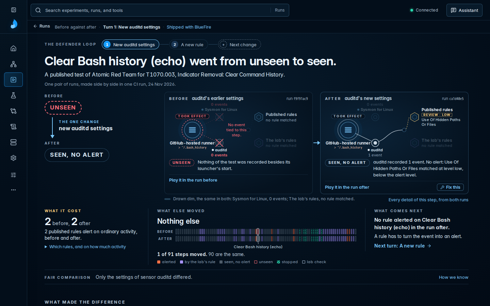
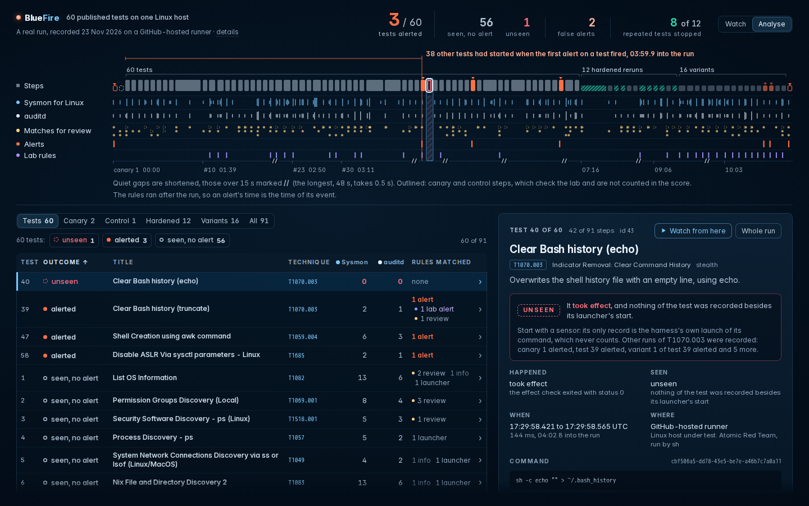
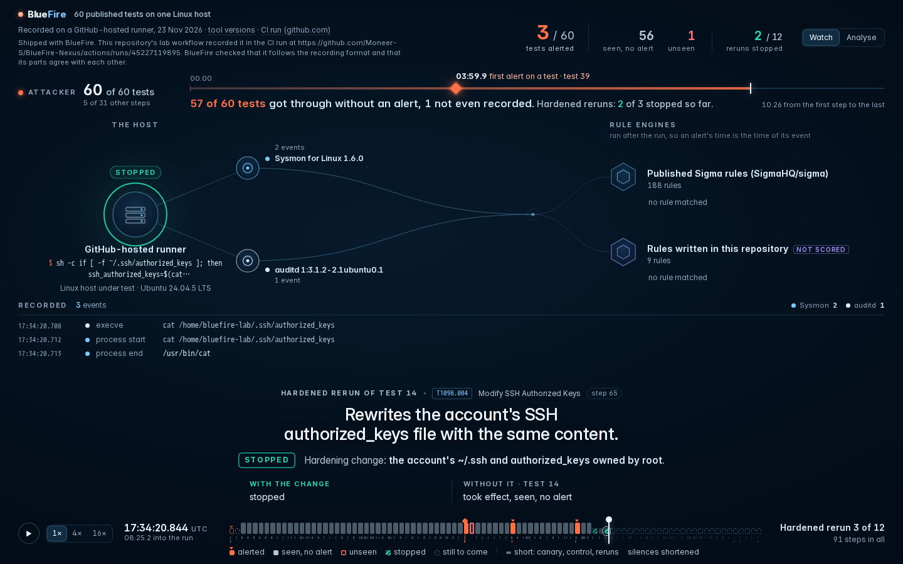

  

<h1 align="center">BlueFire Nexus</h1>

<strong>Watch attacks that ran on a real machine, step by step, next to what its defenses saw.</strong> 
For each step you see whether a sensor recorded it and whether a rule raised an alert. Change a defense, run it again, and see the difference.

Recorded on a throwaway Linux machine: a published rule raises its first alert, then the next test does its work and neither sensor records it.

## See it in a minute

Download [`docs/live-view/replay.html`](docs/live-view/replay.html) and open it. It plays in any browser, offline, with nothing installed, and you can send it to anyone.

Or run `docker compose up app`, open the address it prints, then **Runs**: the app opens with the recorded runs and attacks nothing on your machine.

## What you can do with it

### Change a defense, see before and after

Change a sensor's settings or a rule in a pull request, and the lab's CI shows what it moved. Here a change to the settings of auditd got the test nobody saw recorded.

### Find what nobody saw

The same run, all of it, in a table. The test no sensor recorded comes first, and beside it what happened and where to start fixing it.

### See what hardening stopped

Some tests run a second time with one hardening change made. Each shows whether the change stopped it, next to what the same test did without it.

---

<a href="docs/OPERATOR_GUIDE.md">Documentation</a> · <a href="docs/WORKSPACE.md">The full tour</a> · <a href="docs/INSTALLATION.md">Install</a> · <a href="lab/README.md">How the runs are made</a> · <a href="docs/SCOPE.md">Scope</a> · <a href="LICENSE">License</a>

