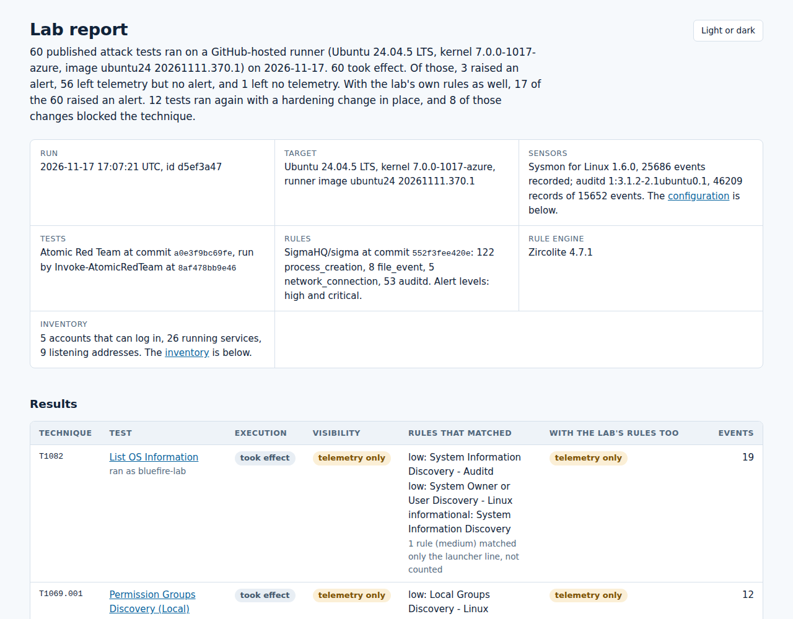

# BlueFire Nexus

A test bench for defenders. It runs published attack tests on a disposable lab
target, records what the sensors on that target saw, has a rule engine evaluate
pinned detection rules over those records, and reports two answers for every
test: did the technique take effect, and what did the defense see. Then it
changes a defense and runs the tests again, to show what the change did.

<picture>
  <source media="(prefers-color-scheme: dark)" srcset="docs/report-dark.png">
  
</picture>

The top of the report of
[run 44042181011](https://github.com/Moneer-S/BlueFire-Nexus/actions/runs/44042181011),
as that run's job pictured it. The whole report is in the run's artifact.

## What it shows today

Everything below comes from runs of the `lab` workflow on GitHub-hosted
runners, each linked. [`lab/README.md`](lab/README.md) gives the details, the
limits, and how each answer is computed.

In [run 44042181011](https://github.com/Moneer-S/BlueFire-Nexus/actions/runs/44042181011),
the workflow's run on `main` of 17 November 2026, on an `ubuntu-24.04` runner
with kernel 7.0.0-1017-azure:

- **49 published tests** from [Atomic Red Team](https://github.com/redcanaryco/atomic-red-team)
  for Linux ran unchanged, one at a time, through its own executor, with
  Sysmon for Linux and auditd recording. All 49 took effect.
- **What the defense saw:** with 188 pinned [SigmaHQ](https://github.com/SigmaHQ/sigma)
  rules, 1 test raised an alert (a rule of level high or critical matched one
  of its events), 48 left telemetry that no rule of an alert level matched,
  and none left no telemetry.
- **Detection rules of the lab's own:** 4 of its 5 rules are accepted: each
  still alerted when its tests ran again with changed input arguments, and
  none matched a baseline of ordinary administration or the runner's own work.
  With them, 9 of the 49 tests raise an alert. The rule for a systemd unit
  written by a shell, written for two tests, also catches a third published
  procedure that was added later.
- **Hardening:** 9 tests ran again with one hardening change each in place,
  such as `/tmp` mounted `noexec` or crontab limited by `/etc/cron.allow`.
  8 of the changes blocked the technique. The ninth shows what its change
  leaves open: a script in `/tmp` still runs through `bash`.
- **A sensor change:** with Sysmon alone, appending a command to `~/.bashrc`
  left no telemetry. With auditd watching the shell start files, the same test
  leaves a record that two pinned rules match
  ([run 44029759448](https://github.com/Moneer-S/BlueFire-Nexus/actions/runs/44029759448)).
- **The target:** each run starts with an inventory of the runner (accounts
  that can log in, running services, listening addresses, the programs the
  tests need) and chooses the tests by it.
- **Before and after:** every run is compared with the latest run on `main`.
  When 30 tests were added,
  [the comparison](https://github.com/Moneer-S/BlueFire-Nexus/actions/runs/44040235251/job/133897072590)
  found the 34 runs of the earlier list with the same answers, and 36 new ones.
- **Seven controls** on the measurement passed: the sensors were ready before
  the first test, every test's markers were recorded, every hardening change
  was removed again, no sensor lost a record, the rule engine read every rule
  and event, a test the pinned rules are known to catch raised its alert first
  and last, and a harmless command raised none. A run in which a control fails
  is reported as failed.

## Run it

The attack tests run only on GitHub-hosted runners, which GitHub throws away
after each job. The `lab` workflow runs on pull requests and pushes to `main`
that change `lab/`, once a week, and by hand from the Actions tab of this
repository or of a fork. Its run page shows the table of answers and how they differ from the
latest run on `main`, and its artifact `lab-run` holds the sensors' raw output,
the results and the report.

The answers can be computed again from a run's artifact, on any machine with
Python 3.10 or newer and [Zircolite](https://github.com/wagga40/Zircolite)
4.7.1:

```bash
pip install ./lab
bluefire-lab evaluate <folder of the unpacked artifact> --engine <path to Zircolite>
bluefire-lab report <folder of the unpacked artifact>
bluefire-lab compare <folder of an earlier run> <folder of a later run>
```

## Not yet shown

- Tests on Windows.
- Attack chains of several steps, and an attacker the bench does not control.
- A lab on your own machine, in containers, with a one-step install and an
  interface.
- The product asking a model to draft a detection rule or a hardening change
  for a gap, and checking the draft on a run before it accepts it.

## Earlier versions

Until November 2026 this repository held an earlier product, which the lab
replaces. It stays in the git history, for example at the tag `v3.0.0-rc2` and
its release.

## License

MIT, see [LICENSE](LICENSE). The lab fetches third-party tools and content at
run time and copies none of them here: see
[THIRD_PARTY_NOTICES.md](THIRD_PARTY_NOTICES.md). Security reports:
[SECURITY.md](SECURITY.md). Contributing: [CONTRIBUTING.md](CONTRIBUTING.md).
