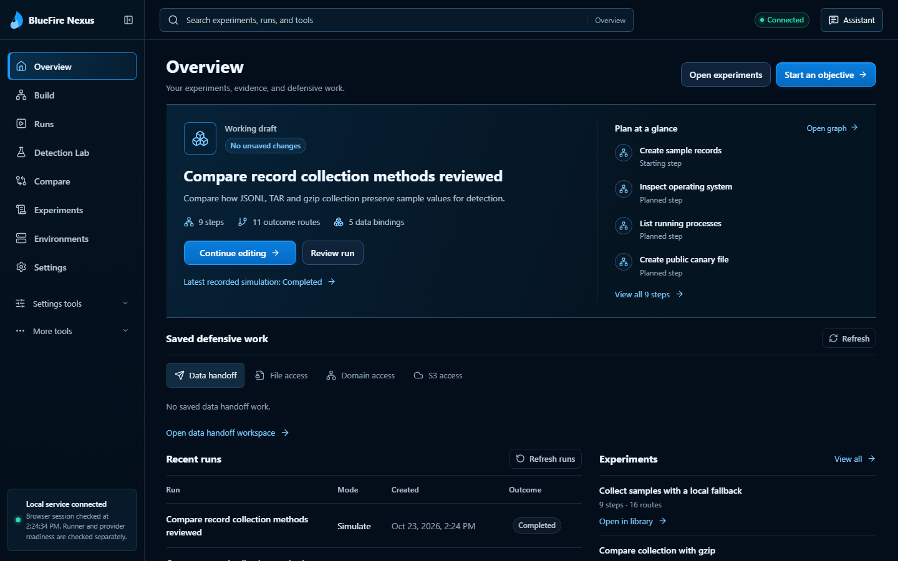
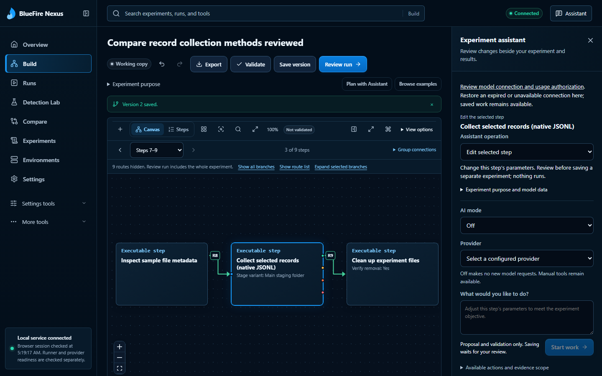
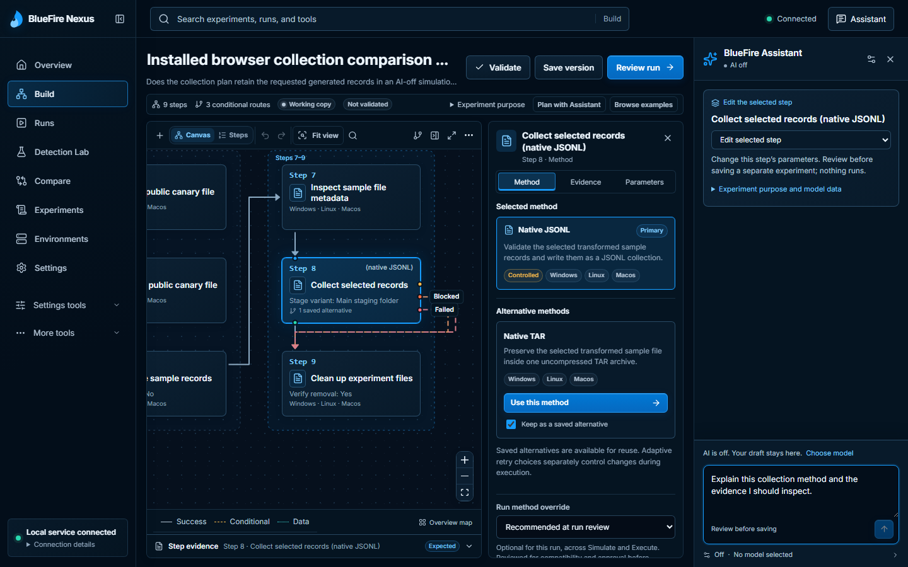
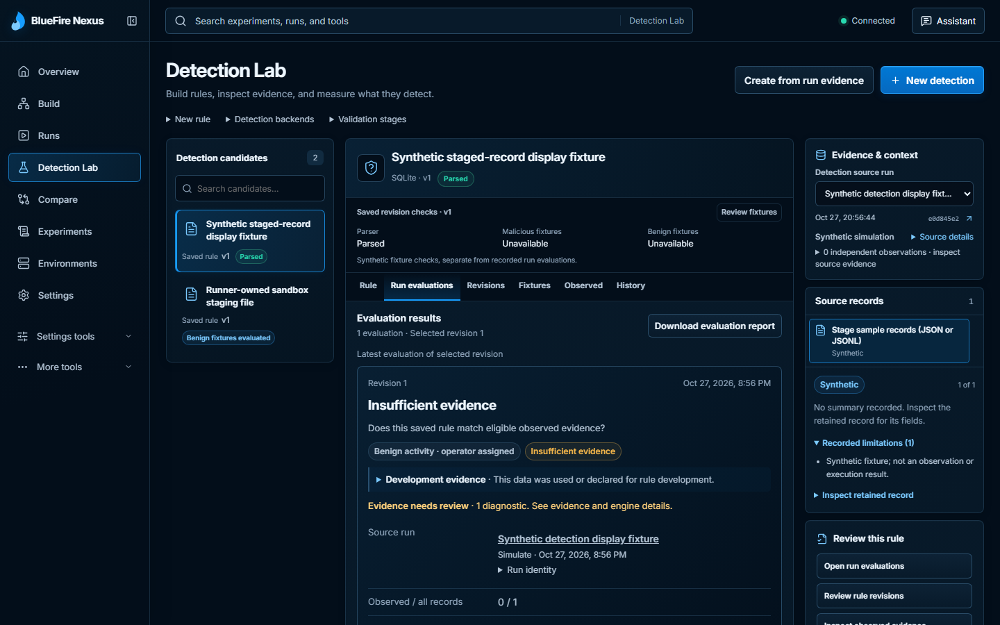
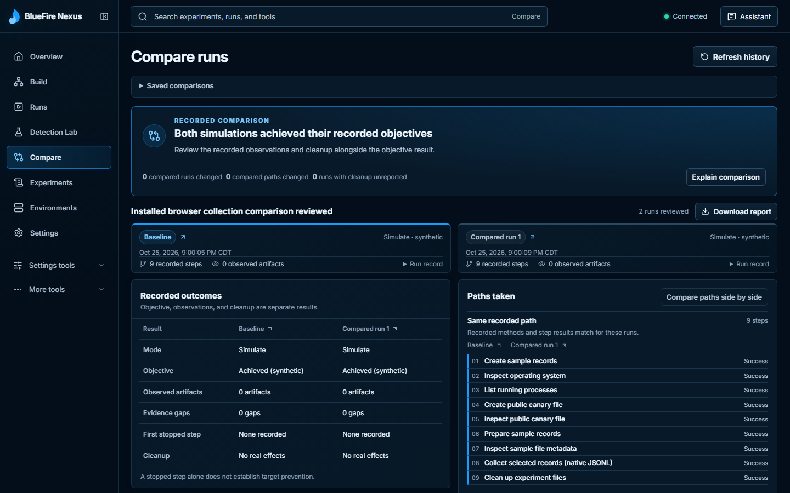

<p align="center">
  
</p>

<h1 align="center">BlueFire Nexus</h1>

<p align="center"><strong>A visual workspace for purple teaming and detection engineering.</strong></p>

<p align="center">
  <a href="LICENSE"></a>
  <a href="docs/INSTALLATION.md"></a>
  <a href="https://github.com/Moneer-S/BlueFire-Nexus/issues/202"></a>
</p>

<p align="center">
  <a href="#get-started">Get started</a> ·
  <a href="#build-the-experiment">Workflow</a> ·
  <a href="docs/OPERATOR_GUIDE.md">Documentation</a> ·
  <a href="https://github.com/Moneer-S/BlueFire-Nexus/issues/202">Roadmap</a>
</p>

BlueFire Nexus is an open-source, AI-first security experimentation and defense-validation workspace. Its desktop-oriented local interface connects objectives, composable attack-chain plans, reviewed execution, independent observations, defensive changes, and fresh retesting.

Connect behavior steps into an experiment, inspect the recorded outcome, then carry a run into detection work or compare it with another result. The optional AI Assistant works alongside the same workspace; manual editing and simulation remain available without an AI provider.



Watch the [post-release development walkthrough](docs/assets/screenshots/desktop-workflow.webm): explore a connected plan, inspect its selected method and expected evidence, open an Assistant draft with graph context, and revisit a saved comparison. The recording uses AI Off and two saved simulations of the same path, whose outcomes are unchanged.

## Get started

BlueFire Nexus 3.0.0-rc2 is a prerelease, not a stable release.

Download the matching wheel and `SHA256SUMS` from the [published 3.0.0-rc2 GitHub release](https://github.com/Moneer-S/BlueFire-Nexus/releases/tag/v3.0.0-rc2). The [installation guide](docs/INSTALLATION.md) links directly to each platform asset and documents a separate development-build option. Development-build artifacts are separate from the RC2 release wheels; post-release UI changes are not included in the published wheels. The package includes the application, browser interface, examples, and native runner. You need 64-bit Python 3.10 or newer; you do not need to build the frontend.

Create a `bluefire-v3` folder and put the intact wheel in a `wheels` subfolder. For a separate development-build CI artifact, first extract the downloaded ZIP and locate the `.whl` file inside; do not extract the wheel itself. For release assets, also put `SHA256SUMS` in `bluefire-v3` and verify against the row with the exact wheel filename; these unsigned checksums detect a mismatch but do not attest publisher identity. Run the commands for your platform from `bluefire-v3`.

<details>
<summary><strong>Windows x86-64</strong></summary>

```powershell
python -m venv .venv
.\.venv\Scripts\python.exe -m pip install .\wheels\bluefire_nexus-3.0.0rc2-py3-none-win_amd64.whl
.\.venv\Scripts\bluefire.exe --runs-dir (Join-Path $PWD 'workspace') ui
```

</details>

<details>
<summary><strong>Linux x86-64</strong></summary>

```bash
python3 -m venv .venv
.venv/bin/python -m pip install ./wheels/bluefire_nexus-3.0.0rc2-py3-none-linux_x86_64.whl
.venv/bin/bluefire --runs-dir "$PWD/workspace" ui
```

</details>

<details>
<summary><strong>Intel macOS</strong></summary>

```bash
python3 -m venv .venv
.venv/bin/python -m pip install ./wheels/bluefire_nexus-3.0.0rc2-py3-none-macosx_11_0_x86_64.whl
.venv/bin/bluefire --runs-dir "$PWD/workspace" ui
```

</details>

<details>
<summary><strong>Apple Silicon macOS</strong></summary>

```bash
python3 -m venv .venv
.venv/bin/python -m pip install ./wheels/bluefire_nexus-3.0.0rc2-py3-none-macosx_11_0_arm64.whl
.venv/bin/bluefire --runs-dir "$PWD/workspace" ui
```

</details>

The launcher opens your browser without passing it a credential. Enter the one-time connection code printed in the terminal. If the browser does not open, use the printed URL. Keep the terminal running and reuse the same `workspace` folder when you restart. A session belongs to its browser tab and exact local address, including the port; sharing the URL does not share access. Relaunch BlueFire for a fresh code after the session expires. `--no-browser` also prints a one-use manual launch link; treat that link as a credential and do not share it.

Open an example in **Experiments** to inspect or edit it in **Build**. Choose **Simulate** to preview the steps without performing their actions, or **Execute** to run them after setting up a compatible runner and reviewing the plan. Simulation does not need an AI account. See [running an experiment](docs/OPERATOR_GUIDE.md) and [the disposable Linux lab](docs/PREPARED_LINUX_LAB.md) for setup.

## Build the experiment

Choose the steps, how each step runs, and what happens next if it succeeds, fails, or is blocked. The topology-focused canvas groups connected steps for navigation and shows conditional routes and data dependencies; switch to the ordered step view when that is easier to review. Edit parameters, add compatible alternatives, and save immutable versions for another run.

Reopen an exact saved version without replacing it, or export the working experiment as JSON.



Work directly in the editor or use the Assistant to draft and revise the plan. From Build, the Assistant can use the current graph and selected-step context. Proposed graph changes remain reviewable before you apply them.



## Follow the run

Review the path taken, collected files and observations, errors, and cleanup status. Open a step to inspect its details rather than reconstructing the sequence from separate tool logs.

A step reporting success and a collector confirming its effects are shown separately. Saved results remain available for inspection, comparison, and export.

## Test the defense

Saved defensive workflows keep the original baseline, reviewed change, and follow-up tests connected. The generated-data receiver workflow distinguishes refusal of the original payload from acceptance of a redacted legitimate payload, retains the reviewed policy separately from temporary test cleanup, and offers a linked fresh retest.

Prevention, detection, execution success, and legitimate-use outcomes are separate results. A new rule evaluated against saved evidence is not a fresh execution against a changed environment.

## Improve the detection

Use **Detection Lab** to bring in a run as the evidence source, write a rule, and inspect matching records alongside examples that should not match. Save revised rules without losing earlier versions or evaluation results. **Compare** keeps run comparisons tied to selected runs, compares detector evaluations separately, and lets you revisit saved comparison snapshots. Download a report for a selected comparison.



Repeat the experiment or change a method, then open **Compare** to see the differences between runs. Compare rule evaluations separately to see which records each revision matched. Export the results when you need to share or investigate them further.



## Work with your model

The optional Assistant works beside the graph and results. It supports experiment planning, supported edits, and detection drafting and revision. Connect a compatible provider when you need it; manual operation remains available without one.

**Assist** asks you to review proposed changes. For supported operations, **Auto** can choose from alternatives included in the run you approved. It cannot add new targets or permissions. **Off** follows the saved plan without calling a model.

See [model setup and supported operations](docs/AI_PLANNER.md). Live-provider validation is still in progress, and external providers may charge for usage.

## Under the hood

Python coordinates experiments and detection evaluation. The Rust runner performs supported actions. React provides the interface, and SQLite stores the workspace's saved records.

The framework includes native methods and reviewed external-tool adaptations, including a Linux gzip test adapted from Atomic Red Team. Detection backends include local SQLite, Sigma conversion to SQLite, and YARA for file content, subject to the installed backend requirements.

[Architecture](docs/ARCHITECTURE.md) · [Execution](docs/EXECUTION_MODEL.md) · [Detection backends](docs/DETECTION_LAB.md) · [Reviewed T1082 source intake](docs/SOURCE_INTAKE.md) · [Development](docs/DEVELOPMENT.md) · [Contributing](CONTRIBUTING.md)

## Current scope

BlueFire brings experiment planning, review, execution, run inspection, and detection work into one local workspace. The optional Assistant supports drafting and revision; manual editing and simulation are available with AI Off. Deterministic and fixture-backed checks do not establish live model inference, and native action support varies by method and platform. Remote runners, broad Active Directory coverage, and production EDR/SIEM collection integrations are not shipped.

Generated fixtures and hosted CI are not customer-host, Active Directory, or AWS validation. S3 audit dispatch remains gated by `DISPATCH_RELEASED = false`. See the [program phases](docs/AI_FIRST_PROGRAM.md), [capability reference](docs/RELEASE_CAPABILITIES.md), [Windows paired readable-baseline guide](docs/WINDOWS_FILE_ACCESS_BASELINE.md), and [roadmap](https://github.com/Moneer-S/BlueFire-Nexus/issues/202).

## License

[MIT](LICENSE). Third-party components retain their own [licenses and attribution](THIRD_PARTY_NOTICES.md).

Use BlueFire only on systems you own or are authorized to test. Keep the web service local. For security reports, follow [SECURITY.md](SECURITY.md).
