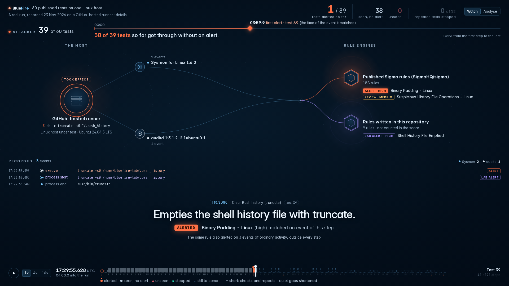

# The live view

The live view plays a recording (see [RECORDING.md](RECORDING.md)) on a map of
its network: each step of the attacker in plain words, what the sensors
recorded, which rules matched, the clock, and the score. It opens in two
places: inside the app, where the Runs screen plays a recorded run (see the
[user guide](USER_GUIDE.md#recorded-runs)), and as the single replay page: one
HTML file that holds the view and one recording, and plays in a browser with
nothing installed. A recording whose run is still going plays as far as it
goes, and the view says the run is still running.

The app ships a recorded attack path: eleven steps of ten published tests on a
path through range one, a network of seven containers watched by Wazuh,
recorded in
[CI run 45555332964](https://github.com/Moneer-S/BlueFire-Nexus/actions/runs/45555332964).
Open it on the Runs screen, where it is listed first, or write it as one page
with `bluefire recordings page 20261125T054314Z-037227 --out path.html`. That
page, made in CI, is
[`docs/live-view/attack-path.html`](live-view/attack-path.html); the run on one
Linux machine shipped with the app is
[`docs/live-view/replay.html`](live-view/replay.html).

## What it shows, and what it never shows

- **Only what the recording holds.** Every step, event, match, time and number
  on screen comes from the recording. A value the recording leaves out is shown
  as not known; nothing is estimated, filled in or made up.
- **A match is not an alert.** An alert is a match of a published rule at level
  `high` or `critical` on an event of the step. A match below that level is
  shown for review, and a match on the shell command that carried the test only
  is shown as a launcher match. Neither counts. A seen step whose only
  published match is on its launcher line says so ("7 events recorded, 1 rule
  matched only the launcher line, which never counts."), and its hint reads
  "No rule matched what the step itself did: start by writing one."; a
  comparison's stages word it the same way. A match at level
  `informational` is shown as "informational" and is not counted for review, in the
  table and in the run's summary alike.
- **A step nobody saw is told in the recording's words.** Its `visibility`
  says why it is unseen; for the lab's run, that nothing of the test was
  recorded besides its launcher's start, the lab's own shell starting the
  test's command, which an attacker's shell would not leave and which never
  counts. The caption, the map, the log of what was recorded, the score's
  tooltip, the lanes, the step's detail and its hint say that, not that no
  sensor recorded anything; the race line only counts the test as unseen.
- **Free text is shown as written, and never reorders the screen.** A step's
  command, what it printed and its plain sentence, the notes and the attacker's
  description and goal may hold a direction mark or override (a published test
  of file names written right to left makes one). Each such character is shown
  as its code in a small tag, "U+202E", and is not applied; in a tooltip or the
  page's title it is written "[U+202E]".
- **Rules written in this repository are drawn apart and not scored.** Their
  engine says "not counted in the score" under its name, a match of one of
  them at alert level is a "lab alert" on every screen ("LAB ALERT · HIGH" on
  a chip), and the score never counts them. In a step's detail, the other runs
  of its technique say "lab alert" beside their outcome where one of the lab's
  own rules alerted on them. A step that the score counts as seen and one of
  the lab's own rules alerted on says so, and the hint under it reads "The
  score counts published rules only, and none of those alerted.": it names no
  published rule to start from and does not say that no rule matched.
- **The head says what the run is, in one quiet line.** Under the title one
  line says what the run is and when it was recorded: "A real run, recorded 23
  Nov 2026 on a GitHub-hosted runner" for a run shipped with BlueFire or
  recorded by the lab's own CI (a run recorded on a developer's machine reads
  "on containers on a developer machine"), "An imported run, not verified by BlueFire"
  for an imported one, and "A run of unknown origin" for a page that does not
  say where its recording comes from. Its "details" opens the rest: who
  checked what, the link to the CI run that made it, the tool versions and the
  recording's notes. While watching, the score's head says "tests alerted so
  far" ("steps alerted so far" on an attack path), since its counts go up as
  the run plays; at the end of the run they are
  the run's own. The hardened reruns are counted apart as "hardened reruns
  stopped", of all the hardened reruns of the run ("3 of 12"), and while they
  play the race line's sentence counts them the same way ("Hardened reruns: 3
  of 12 stopped so far."). The legend under the timeline calls their short
  marks, and
  those of the canary and control steps, "short: checks and repeats"; its
  tooltip names their roles and says that none of them is a test or in the
  score of tests.
- **The rules' time is said once.** Where the rules ran after the run, an
  alert's time is the time of the event it matched. The race line says so
  beside the first alert's time, "(the time of the event it matched)", and
  analyse mode's lanes say it again under the axis.
- **Quiet gaps are shortened, and the screen says so.** Every step gets one bar
  on the timeline, and the time between two steps plays as a short beat
  whatever its real length. The legend under the timeline says "quiet gaps
  shortened", analyse mode's lanes say "Quiet gaps are shortened" (their tooltip
  says the quiet time between two steps is drawn shorter than it lasted), and
  the clock always shows the recording's own time. A step plays its own
  stretch in the first part of its time on screen, a little under half of it;
  for the rest its clock stands at the step's end while its outcome is read. A
  step whose last match fires near its end stays on screen longer, its clock
  held at the step's end, until that match's light has reached the rule engine
  and the step's outcome is told.
- **A step is told once what it counts has arrived.** **Nothing says how a
  step ended before its clock reaches its recorded end.** Until then the step
  is running: the map's badge says "running", and neither the map, the caption
  nor the score says how it ended. An alert is told when it was raised, also
  while the step still runs, and the step counts as alerted from that moment;
  the map still says "running" until the step's end. From the step's recorded
  end on, the badge says what the step did ("took effect", "no effect" or
  "stopped"), never "running". Any other step's outcome (seen or unseen, with
  its counts) is told from its end on, once the light of its last event has
  reached the rule engines, so the
  caption's "1 event recorded" never stands beside a log that says "Nothing
  recorded." or a map that counts "0 events": the three count the same events
  at every moment, and the log says "Nothing recorded." only of a told step
  that has no event at all. A step whose last event comes near its end holds,
  its clock stopped at the step's end, until then.
- **A step plays its own stretch of the run, unmoved.** A step's bar plays
  from its `started`, or its earliest event or match when a sensor stamped one
  a moment before, to its `ended`, or its latest event or match. The format
  has steps run forward with no overlap and no step's events inside another's
  stretch, and the page refuses a file that breaks that, so no step is moved or
  squeezed to fit, and the clock, the log, the analyse lanes and a step's
  detail read the same times. "The step ended", wherever it is said or
  counted, is the step's recorded `ended` (the end of its stretch when the
  recording has none).
- **A match fires at its moment.** Its moment is its `raised` time where the
  rules ran live and its `time` where they ran after the run, the moment the
  recording's `first_alert` and `first_alert_seconds` count. It fires then, as
  soon as the earliest event it names has arrived; it does not wait for later
  events it names, which arrive after it as events of a match already told.
- **An alert raised after its step ended arrives late, and is shown when it
  arrives.** In the path through range one shipped with the app, Wazuh's
  manager judged the events as they arrived, and its first alert, on step 1,
  was raised 280 ms after the step ended. Where the rules ran live, a match
  fires at its `raised` time.
  While a step is on screen it is told as it stood at its end, so a step whose
  alert was not raised yet is told as seen (or unseen) with no alert by the end
  of the step. When a match of a step is raised after that step ended, on
  whatever is on screen then (a later step, or the silence after its own
  step), its rule engine lights, the log gets a line that says how long after
  its step ended it was raised (called "alert" when it is one), and
  one line under the step names it and says the same. When several arrive together, that line counts and names every
  one of them, the log names the earlier ones on a line of their own, and each
  engine says how many more arrived on it, so nothing that the score counts
  goes unnamed. A match raised after its step's `ended` that still fires while
  that step's own stretch plays (a sensor stamped one of its events later
  still) is late in the same way, and the step waits for it: it is told
  alerted when that match fires, never first as seen. What is on screen
  holds, its clock and the race's head stopped at that arrival's moment, until
  that line has been there for three seconds; the rest of the silence then
  plays. From that moment the score, the race line and
  that step's bar on the timeline count it as alerted, and not before; when it
  fires in the silence after its own step, while that step is still on screen,
  the step's verdict and its host's badge say alerted from then too, and its
  sentence still says there was no alert by the end of the step. A match
  raised after the last step ended plays in one more short silence at the end.
  In analyse mode each such match says how long after its step ended it was
  raised. Where a step has several alerts, the caption, the first alert's flag
  and the step's detail all name the one that fired first on screen (by its
  `raised` time where the rules ran live), not the one whose event came first,
  and a rule is named only once its alert has fired. The same holds for every
  match, at any level: the caption's count of rules for review, its "Fix this"
  hint, its text for screen readers and a rule engine's "no rule matched" speak
  only of the matches that have fired by then, and a match that fires later
  appears when it fires. Analyse mode shows the whole run at once and lists a
  step's matches in firing order.
- **The score is the recording's.** While watching, the score counts a step
  as alerted, seen or unseen once the screen has told its outcome, and as
  stopped from its recorded end on, when its host's badge and the log say it
  was stopped, as the race line's count of stopped reruns does; at the end of
  the run it is the recording's `score`. False alerts, on ordinary activity
  outside every step, have no times in a recording, so watch mode shows them
  only at the end. In
  analyse mode it is the whole run's score from the start. False alerts are
  shown only with the ordinary activity they are counted from. The time to the
  first alert on a test (on an attack path, on a step) is read from the alerts
  themselves, up to the moment that alert fires (its `raised` time where the
  rules ran live), and counted as the screen counts it. It is a time "into the
  run", on the same clock as the clock beside the timeline and the race track,
  and is named the same way wherever it is said: "The defense raised its first
  alert on step 1, 01:16.4 into the run." For a test list that clock counts
  from the start of the first step's stretch, its `started` or an event of it
  stamped a moment before (in the shipped run, the canary's first event, 2 ms
  before its start); the race track's 00:00 says so in its tooltip. For an
  attack path it counts from the first step's recorded start, the same clock
  the race compares with the goal.
- **An attack path's race and its goal.** In the path through range one
  shipped with the app, the first alert came 01:16.4 into the run and the
  attacker reached its goal 12:10.5 into the run (see [the goal on the
  map](#what-a-network-of-several-hosts-shows)). An attack path begins with a
  step of role `test` that has a recorded start, and its race counts from that
  one moment: the first alert's number,
  the goal, the race track's 00:00, the flags' places on it and the clock's
  time into the run.
  The goal falls `score.goal_seconds` after it, even where an event is stamped
  before that start: at the end of the step that time names to the
  millisecond, as the import checks it, so a time rounded a fraction of a
  millisecond past the last step's end is still told. The race line and the
  run's summary name the attacker's goal where they say it was reached. When
  the first alert came
  before the goal, the race line tells the goal only once that alert has been
  told, never the other way round. A file whose `score.first_alert_seconds`,
  or a step's `first_alert`, says otherwise is refused on import; the page
  shows what the alerts say.
- **A light takes a match's colour only once the match has fired.** What a
  sensor records travels as light to each rule engine. Where a rule engine ran
  live and raised a match a moment after the event, the event's light travels
  as a plain event until the match is raised, and from then in the match's
  colour; the engine lights when the match reaches it, as before. Where the
  rules ran after the run, a match fires at its event's time, so its light
  has the match's colour from the start.

## The map of a network

The map is drawn from the recording's `network` alone: nothing in it is placed
for one network by hand.

- **One host** stands on the left with its sensors around it, the rule
  engines on the right.
- **Several hosts** stand in columns from left to right. The first column holds
  where the attacker starts, and every other host that reaches the network and
  that no host reaches, such as a client; each other host stands one column
  after the nearest host linked to it. A column's hosts stand in rows, ordered
  so that fewer links cross. The defense's own server stands after the last
  column, where the sensors' lines join, and the rule engines last.
- Every host's name and role stand under it. A host's badge ("running" until
  the clock reaches the step's recorded end, then what the step did) stands
  above it, or, when that place is taken, on the top of its
  ring, and only when both are taken beside it or under its name: never on a
  name. Each sensor stands beside its host, where its name covers nothing and no
  link runs through it, on the side its line to the defense leaves from, so the
  line never runs back across its host. A pair of hosts linked both ways gets
  one line with both labels. A sensed host's link to the defense server where
  the sensors' lines join is drawn by those lines rather than a second line,
  until a step crosses it: the attack's path then draws it, with its arrow and
  its step's number. Any other link to the defense, from it or to another
  defense host, is drawn.
  Two hosts of one column are linked by a curve to one side, and a link that
  would run through a host or a name bends around it. A link's label sits where
  no other line runs under it, when its link has such a place.
- The link a step crosses, from its `from` host to its host, is lit, and the
  links that the steps before it crossed stay faintly lit: the way the attacker
  came.

### What a network of several hosts shows

On a map of several hosts (range one's seven, for example) the screen says the
same things as on one host, laid out for a network:

- **Networks are fields.** A network that several links share is a faint field
  round the hosts on it, with no border, named once in small capitals where
  the field begins ("EDGE", "INSIDE + MGMT"); its links are not drawn one by
  one. Two fields side by side never overlap; a host on both networks, such as
  web, stands where the two fields meet. The network's head says how many
  hosts there are and which have no sensor ("no sensor on attacker, inet or
  client").
- **The defense is a side of its own**, at the right: the defense host (the
  Wazuh manager) and the rule engines stand together in a field headed "The
  defense", never in a field of the hosts they watch. One quiet line at its
  foot, under the defense host, says which sensors there are and how they
  report: "Wazuh agent 4.14.10 on web, db and build, reporting to manager over
  mgmt." That line never lies on a host's circle, words or badge: where the
  foot of the defense's side has no room clear of them, it is left out. An
  engine shows at most two matches whole, and fewer where two would not fit
  above that line; the rest are counted ("+ 6 more rules for review"). A
  match on the launcher line is named among them in a few words ("launcher
  line, not counted", or "launcher line (2 rules), not counted"), and on a
  map of one host "more" is said once ("+ 3 more for review · 1
  informational · launcher line, not counted"), so that the line keeps its
  reason inside the engine's box.
- **The attack's path is the strongest line.** The hop of the step on screen
  glows, with an arrowhead; each earlier hop keeps its arrowhead and grows
  fainter the longer ago it was crossed. Beside each hop, never on its line and
  a clear gap from it, lit or not, stand the numbers of the steps that crossed it ("5 · 9"), so the picture of
  the goal tells the order of the attack. A step that stays on its host (no
  `from`, or `from` the same host) lights a short bright arc on that host while
  it runs. The caption names a crossing step's hop in words beside its number:
  "from web to inet". A hop stays inside the map's drawn fields, under the
  column heads and above the fields' foot; where it has to go round a host's
  words, it takes the shorter way round.
- **Each sensor's count is in words.** An agent that the defense's line names
  once has its count under its host's role: "agent · 8 events", or "agent ·
  1,439 kept" where the recording kept fewer of the step's events than were
  recorded. Every sensor that recorded the step is counted, the agent of the
  host it ran from too, and the log's key names each by its host ("Wazuh agent
  on web 3", "Wazuh agent on build 17" at step 9).
- **An alert is told the same way everywhere.** The rule engine names it as an
  alert ("ALERT · HIGH", its title, where it was raised: host, step and rule
  number). An alert raised after its step ended says so in one wording, on the
  engine, in the log and in the caption alike: "raised 280 ms after the step
  ended". The log calls that line "alert". The host it was raised on has its
  chip under its words, strong at the moment it fires and quieter after, with
  its time; the run's first alert carries the race line's orange diamond and
  the race line's time ("first alert 01:16.4").
- **The goal is a place on the map.** The host where the path reached its goal
  has a white ring and a "goal reached" badge with the race line's white
  diamond and its time ("goal reached 12:10.5"). The race line's sentence at
  the goal says both facts, the attacker's first: "The attacker reached its
  goal, “build's signing secret reaches inet”, 10 min 54 s after the first
  alert, with no step stopped."
- **The step's words keep their room.** The log holds three lines on a
  network; lines a step leaves empty go to the story band below, which stands
  in the middle of its room, so no empty band opens between the log and the
  sentence. See [What gives way in a short room](#what-gives-way-in-a-short-room).
- **The goal's badge stands clear of its host.** A badge stands above its
  host, clear of the ring a lit host wears. Where a row at the top of a short
  map leaves no room above it, the badge stands beside the host, starting past
  that ring however wide the badge is ("goal reached 12:10.5" is the widest),
  or under its words; it never lies on the host it marks or on a host's name,
  no line runs through the place of a badge of a host a step runs on (the
  host's own links included, as wide as the widest badge it wears), and a
  hop's numbers keep clear of it. A field's edge does not run across the badge
  of one of its hosts: where the column heads leave no room above a badge, the
  field's top runs under it, and the badge stands above the field. A host that
  stands on the border between two fields wears its badge across that border.
  At the map's least height, where no place near a host is clear of every
  edge, the fields stay drawn and a badge may lie a few pixels across one.
- **A field's name stands in a free corner of its field.** The top left corner
  first, then the top right, the bottom left and the bottom right: the first
  where no host, name, badge's place or line is under it, and where no hop's
  number could stand beside a line the path may run on. A field with no corner
  free is not drawn unnamed: no field is drawn then, as below. A field
  never covers a host of another field: where its box would, it gives up the
  edge that costs it least. The fields are drawn only when every one can be
  drawn whole: each box round all of its hosts (a host on two fields standing
  on the border between them) and none of another's, its name in a free
  corner, no two on each other. Otherwise, as in a map whose columns fold in a
  small window, no field is drawn, and the hosts and lines stand alone; each
  host's details still name its networks.

A map of one host is drawn as before.

### How the map fits

- **Every column fits, or the recording is refused.** Hosts, defense hosts,
  the sensors of one host and the rule engines each stand in a column that
  fits the map's height: drawn closer together down to a least pitch, and
  where that is not enough the map grows taller. A column holds at most four
  hosts one above another; a longer one stands as several columns side by side.
  Two defense hosts stand far enough apart for the upper one's name and role
  and the lower one's sensors and badge above it, and the top one low enough
  for its sensors under the column heads. The defense hosts' sensors are placed
  first, above their hosts; the field's sensors make way for them, and no
  sensor stands on another host, its name or a rule engine while there is a
  free place.
  The map draws at most 12 hosts (3 of them defense hosts), 16 links, 16
  sensors with at most 4 on one host, and 4 rule engines; the service and the
  page refuse a recording beyond that, saying which limit it passes (see
  [RECORDING.md](RECORDING.md)). A link from a host to itself, or one given
  twice, is refused the same way.
- The map uses the room the screen gives it. A network that needs more room
  than that makes the map taller, and the view then grows and scrolls as it
  does in a small window (see [Two modes](#two-modes)), with the play button,
  the speeds, the clock and the timeline kept at the foot of the window, and
  the step's words below the fold as a whole (see
  [What gives way in a short room](#what-gives-way-in-a-short-room)). A map
  squeezed to no height by the rows around it still claims the least height
  it needs.
- **Columns fit the window.** Two columns stand at least 112 pixels apart, and
  far enough apart for a stack of sensors' names and counts beside a host. The
  last column stands far enough from a defense host for its sensors' words.
  When a network's columns do not fit side by side at the window's width, they
  fold into bands of rows, one under another: the first band runs left to
  right, the next right to left, so a chain reads on from the end of one band
  to the start of the next, and folded columns stand far enough apart for a
  lone sensor's name beside its host. A folded column holds at most eight
  hosts; a network that would need more keeps the width its columns need.
- **A narrow window.** The map never places anything outside itself. It is at
  least 960 pixels wide; in a narrower box, or when a network keeps a wider
  width, the map keeps its width and scrolls sideways inside its box. A
  network is laid out at widths in steps of 16 pixels and stands in the middle
  of its box, so dragging a window's edge lays it out once a step; layouts
  already made are kept.
- **The words for silence stand by their host.** On a network, "It took
  effect." and, under it on at most two lines, what the recording says of the
  unseen step stand near its host, a defense host too, in a box that covers
  no host, name, sensor, link label, rule engine or the host's own badge. Other lines may run under it, but the host's own
  links, one of which the step came along, only where no place near the host
  is free of them. Where no place near a host is free, the words stand at the
  nearest free one: in range one's example, for the hosts of its first two
  columns, which link labels ring, and at 1024 by 768 for web and db too. When
  some host's words find no free place on the map at all, room is kept for
  them under the bottom row. On a map of one host and no defense
  host they stand in the corridor between the sensors and the rule engines, as
  before, or above or under the host's sensors' words when a long name reaches
  into the corridor.
- **Every sensor that recorded the step is counted where it stands.** A step's
  events can come from sensors on several hosts. Each of those sensors shows
  its count on the map, and the log's key names each of them (two of one name
  told apart by their host); their counts add up to the number at the head of
  the log and in the caption. The step's own host's sensors are always in the
  key, a silent one with 0.
- **Long names are cut where there is no room, and kept whole within reach.**
  On a network a host's name is cut at its role's width and its role after
  three lines; beside a defense host, the last column's words and the defense
  host's each take half the room between them, and the defense host's stop
  short of the rule engines. A small sensor's name is cut at 150 pixels, and a
  rule engine's name where its column ends. On a map of one host, the host's
  words stay on the map, and a sensor's name stops short of the rule engines
  or a defense host level with it. In the log's key a name is cut at 220
  pixels, and its whole is in the entry's title. A host's words open its
  detail by pointer and by keyboard (each host's words take focus): its whole
  name and role, its system, its addresses, or that none was recorded, and
  each of its sensors with what it records. The detail stays within the map,
  however near its edge the host stands.
- When a recording's rule engines did not all run at the same time, the head
  over them says so, and each engine says whether it ran live or after the run.
  A map of one host beside a defense host is headed "The network", with its
  count of hosts and sensors.

## Two modes

- **Watch** plays the run. The caption tells the current step in plain words,
  then its outcome: alerted, seen with no alert, unseen, stopped. A step that
  got through without an alert has a "Fix this" button. On the single replay
  page it opens the step's detail, which says where the gap is. Inside the app
  it opens the step's own page, the place where fixing it starts (see "Fix
  this" in [USER_GUIDE.md](USER_GUIDE.md)), and its "Back to the run" returns
  to the moment it was opened from. Above the map the race line flags the
  first alert on a test, and on an attack path the first alert on a step and
  the goal. A flag's label opens
  to the right of its flag, or to its left near the end of the line; when the
  two labels would touch, they stand one to each side of their flags, or the
  goal's a row higher.
- **Analyse** shows the whole run on one axis, the table of every step with
  filters by role and outcome, and the chosen step's detail: how it went, its
  times, the command, the rules that matched and its events. "Watch from here"
  goes back to watch mode at that step. The table opens on the tests, or on
  every step when the chosen step is not a test (as at the start of a run,
  where the first canary is chosen) or the recording has no test. No cell of
  the table is cut: a long title or a long list of the rules that matched wraps onto a second
  line, and a hardened rerun's "not stopped" stands under its outcome. The title takes the room the other columns leave, each as wide as its
  contents need, and where the recording keeps fewer of a step's events than
  were recorded, how many it keeps of how many were recorded stands under the
  title, not beside it ("1,439 of 1,857 events kept"): the sensors' columns
  count the kept events, as their tooltips say. The column of rules matched
  counts rules, each once however often it matched, as the step's sentence
  does: step 1 of the attack path reads "1 alert · 6 review · 2 info", though
  its six rules for review matched 1,361 times. The table and the detail beside it let their last visible lines fade
  out at their foot, with as much room after their end, so no row or line is
  cut hard by an edge. When the table scrolls to the chosen row, it stands at
  a row's edge under its head with the chosen row whole, and it finds that
  place again whenever its rows change height: as the columns get their
  widths, when the font has loaded, when the window changes size. Its end is
  a row's edge too, the last row whole above the fade. Inside the app the
  detail of a step that got through without an alert also has "Fix this",
  which opens the same page.

In a small window, or a large one zoomed in, and wherever a network's map
needs more height than the window gives, the view grows with what it holds
and the page scrolls; at phone width its bands stack. While watching, the
transport (the play button, the speeds, the clock and the timeline) stays at
the foot of the window as the rest scrolls under it, so playing, pausing and
moving on the timeline stay in reach. The network map keeps its least width
and scrolls sideways inside its own box; nothing else scrolls sideways.
Nothing is cut off beyond reach. The app's page of a recorded run does the
same at the same window sizes.

### What gives way in a short room

The step's sentence, the line with its outcome (and "Fix this" where the step
has it) and the hint under it never give way: in watch mode they stand whole
above the transport, without scrolling, in the room the app gives the view on
a laptop or a desktop window (1280 by 720 up to 1920 by 1080, less the app's
own bars). The band that holds them keeps the height of its eyebrow, a
sentence of two lines, the outcome's line and the hint at every step, so the
map and the log stand still from step to step; a step whose words need more
makes the band taller, never cut. When the room is short, the parts give way
in this order:

1. **The log shows fewer lines**: three on a network and four on one host,
   then two, one, and at last only its head line, which still counts the
   step's events and opens the rest in Analyse. A log of one line at an alert
   raised after its step ended gives that line to the alert, as a longer log
   writes it; where the log folds matches into one line, it counts each kind
   as what it is ("1 alert rule, 5 rules for review and 2 informational").
   When no event has a line, the head says how many there are and how many of
   them Analyse lists, the events the recording keeps of the step: "19 events,
   all 19 in Analyse", "1,857 events recorded, 1,439 kept here, all 1,439 in
   Analyse", "1 event, listed in Analyse"; when some have, "N more in
   Analyse" counts those not shown.
2. **The map takes less height**, down to its least: on a network, first the
   height at which every row keeps room above its hosts for their badges, and
   then, with the rows closer and a lower host's badge beside it, the least
   height at which no host, name, count, badge or line lies on another any
   more than at the roomier one.
3. **Only then does the page scroll.** The map keeps its least height and
   reaches down to the transport, so what does not fit, the step's words, is
   below the fold as a whole and never cut in half by the transport.

The view measures its parts to decide this (`room.ts`); in a short window the
band's words stand a little closer.

## Keys

| Where | Key | Does |
| --- | --- | --- |
| Watch mode | Space | Plays or pauses, unless a button, link or the timeline has focus |
| Timeline | Left, Right (or Down, Up) | One step back or on; on the last step, on goes to the end |
| Timeline | Shift with an arrow | One second back or on |
| Timeline | Page Down, Page Up | Ten steps back or on; on never goes back |
| Timeline | Home, End | The start or the end of the run |
| Analyse: the lanes | Left, Right, Home, End | Moves between steps |
| Analyse: the table | Up, Down, Home, End | Moves between rows |
| Details under the title | Escape | Closes the panel |

## The page's address

The replay page reads where to start from its address, for example
`replay.html?step=43&paused=1`:

| Parameter | Value | Does |
| --- | --- | --- |
| `step` | a step's `id` | Opens at that step |
| `at` | 0 to 2 | How far into that step, 0 its start and 1 its end. Above 1 and below 2, how far into the silence after it, where that step is still on screen; 2 or more is that silence's end, which is the next step's start. On the last step, which has no silence after it, anything above 1 is its end. 0.6 when left out. Read only with `step`. |
| `paused` | `1` | Opens paused |
| `mode` | `watch` or `analyse` | Opens in that mode; analyse opens paused |
| `select` | a step's `id` | The step whose detail analyse mode opens on |

A step's `id` is the recording's own, and a step's detail in analyse mode shows
it, so that a link can be written by hand. On screen a step is named the same
way everywhere, and one function (`unitWord` in `format.ts`) decides the word
for each kind of recording:

- **A list of tests on one host** names a test "test N", its count among the
  tests in run order, as the score counts them, and counts tests: "3 / 60
  tests alerted", "first alert · test 39", "Test 39 of 60".
- **An attack path** names each step "step N" and counts steps, everywhere a
  step is named or counted: "1 / 11 steps alerted", "first alert · step 1",
  "The defense raised its first alert on step 1, 01:16.4 into the run.", "Step
  9 of 11" over the step's detail and beside the timeline, with no second line
  that says its place again, "step 10" under the lanes' time axis, and one tab
  of steps in the analyse table where a tab of tests would hold the same rows.
  The published test a step ran keeps its own title and technique: the
  technique's chip and the test's title beside it.

Any other step is named by its role and, for a rerun, by the step it reruns
("canary 1", "the control", "hardened rerun of test 12", "variant 2 of test
39"). Where room is short, the analyse table's first
column writes a test as its number alone, and the lanes' time axis a test of
a list as "#28";
an axis label of a rerun or a variant holds its time alone, with the name in
its tooltip.
Its place in the list of steps is shown only as progress ("42 of 91 steps"). In the shipped run, `?step=43` opens test 40.

An address that names a step the recording does not hold gets one line under
the title that says so, in both modes; the view then opens at the start of the
run, or analyse mode on the whole run.

Inside the app, at `#/runs/recorded/<id>`, the same parameters follow the
viewer. A place in a silence counts the silence as it plays, its hold at a
late arrival included, and is written in thousandths rounded up, so the
address opens the same moment with the same late arrivals on screen. An
address that names a step the recording does not hold keeps naming it, beside
the line that says so, until the viewer moves from where the view opened.

## Making the page

```bash
bluefire recordings page RECORDING_ID --out replay.html
```

The command writes a new file: the packaged page `bluefire/ui/replay.html`
with the recording put inside it (see [CLI.md](CLI.md)). `bluefire recordings
list` gives the ids. A page is made of a finished run: the command refuses a
recording that is still running (it has no end time yet) and writes nothing;
a running recording is watched in the app. Every finished recording the app
keeps plays on the page: the import refuses, with a plain reason, anything the
page could not show. The browser test
`frontend/tests/service/recording-parity.spec.ts` gives a small set of
recordings at the edges of the format to both, and checks that the page plays
each one the app keeps and refuses each one it refuses. The page is one file of
under 1 MB plus the recording.
It carries its own script, styles and font, and its content security policy
lets it load nothing and connect nowhere: the page makes no request by itself.
The one way out is the link to the CI run that made the recording, in the
details under the title, shown only for a GitHub Actions run at
`https://github.com` (of the recording's own repository, when the recording
names one), and followed only when someone clicks it. The text of a recording is always shown
as text, never read as markup.

Beside the recording the command writes where it comes from, as the app lists
it, and the page shows that note in the details the line under the title
opens; the line itself says in a few words what the run is. A recording
shipped with BlueFire says so and names the CI run that made it. An imported
recording says what BlueFire checked, that the file follows the format and its
parts agree, and what it cannot confirm: that the steps ran, where and when,
and the engine and CI run the file names. A page that holds no such note, a
template filled by other means, says that it does not say where its recording
comes from.

Every run of the lab leaves a page of its own: the lab workflow fills the same
template with the run's `recording.json` (`bluefire-lab replay`, see
[lab/README.md](../lab/README.md)), and that page says it was made by the lab
workflow in the CI run it names. The command reads that from GitHub's own
variables of the run it runs in. Run anywhere else, it writes a page that
reads the file as imported: it says the CI run the file names was not checked,
and does not link it.

## Pictures made in CI

The pictures of the live view are made in CI, on a clean runner, never on a
developer's machine. After its browser tests, the job `screens in a browser`
of the app workflow (`.github/workflows/app.yml`) runs
`frontend/tests/pictures/live-view.ts` against the real service and the two
recordings shipped with the app. It makes the single replay page of each with
`bluefire recordings page`: `replay.html` of the run on one Linux machine and
`attack-path.html` of the attack path.

Of the run on one Linux machine it takes pictures of its page, paused at
moments it finds by the steps' outcomes: the first alert on a test, the unseen
test, a test seen with no alert, a hardened rerun that was stopped, analyse
mode with the whole run and with the unseen test's detail, and the first alert
again at 1920 by 1080.

Of the attack path it takes pictures of its page at moments it finds by what
the steps are: late in the step that runs from the web server to the build
server and was matched by a published rule below alert level, the step that
logs in there with the key it found and copies files back, seen with no alert
and with "Fix this" (`path-no-alert.png`, 1440 by 900), and the end of the
last step, the goal reached, at 1920 by 1080 (`path-goal-wide.png`).

Inside the app it takes the Overview, which leads with the attack path and the
turns of the loop (`app-overview.png`), the Runs screen with
both recorded runs, its part "Before against after" with the two comparisons
shipped with the app (`app-runs-pair.png`), the page of the pair of runs
(`app-pair.png`) and the page of the run evaluated with two rule sets
(`app-rule-pair.png`), each with both stages drawn, the run on one Linux
machine opened from the Runs screen, with Analyse pressed and the first row of
the table clicked, the unseen test, its detail beside the table with "Fix
this" (`app-analyse.png`, 1440 by 900), then the Hardened tab and "Watch from
here" on a rerun that was stopped, paused late in it, the rerun told stopped
with its hardening change named and what the same test did without it
(`app-watch-stopped.png`, 1440 by 900), and that run's page on the first
alert, at 1920 by 1080 so that every rule title fits. Before that it
opens the recorded run's page at 1440 by 900 too, on the first alert, and on
the test with the longest command, whose command takes two lines under the
host.

It also makes `live-view-loop.gif`, the loop at the top of the
[README](../README.md), from the attack path's page, 1000 pixels wide at 10
frames a second (`frontend/tests/pictures/loop.ts`). Its first frame is the
end of the last step, the goal reached: every hop of the path drawn on the map,
the first alert's mark on the web server, the goal's on the stand-in internet,
both marks on the clock. It is held 2.5 s, so that a still or a link preview
shows it. Then the first step plays from its start, four times as fast as the
view since it is a long step, until a second after its alert has fired, held
1.5 s; then the step that copies files back from the build server, twice as
fast, from its start to late in it, held 1.5 s; then the last step from its start to its end,
which is the first frame again, so the loop closes with no seam. Each frame is
the page opened paused at one place of the recording, a step and how far into
it as the address names it, so the same recording gives the same frames on any
machine; [sharp](https://github.com/lovell/sharp) puts them together.

Each picture is taken when the page is at rest: no animation runs, nothing on
the page moves from one frame to the next, and two pictures taken one after the
other are the same. Inside the app three more things are settled first. The top
bar must say "Connected" before the pictures and after them: it says
"Connection unchecked" for a moment when its last check of the service is more
than 30 seconds old. A screen is pictured from its top, since one opened from a
scrolled screen can keep a few pixels of the old scroll. And the app's
entrance animation, once ended, is let go, so the page is drawn as its own
style draws it rather than as the animation's last frame, which can come out a
shade apart. CI runs
[45697835609](https://github.com/Moneer-S/BlueFire-Nexus/actions/runs/45697835609)
and
[45699524060](https://github.com/Moneer-S/BlueFire-Nexus/actions/runs/45699524060),
on two commits that differ only in the pictures copied in, gave the same bytes
in every file but the artifact's own note of its commit.

The script fails if a page prints an error, if a replay page asks for anything
beyond its own file or the app for anything beyond the service, if a picture
or the page at 1440 by 900 would show a rule title cut short or a wrapped one
reaching the next rule engine, if the host's label reaches below the map, if
the race line of a watched moment is cut short, if the lanes' time axis has
no label past its middle, or if a cell of the analyse table it pictures is cut
short or a title there takes more than two lines (three where the live view
is narrower than 1440 pixels, as beside the app's rail). It also fails, with the sentence to change, if the
shipped recordings and comparisons no longer bear out what the
[README](../README.md) says of them: the caption under the loop (Wazuh's stock
rules alerted on the first step, the password guessing against the web server,
about a minute in; the goal, the build server's signing secret on the
stand-in internet, was reached about eleven minutes after that, by a last step
no rule alerted on), "Read what no rule alerted on" (every step after the
first seen with no alert; at step 9, the step of its picture and the one it
says to drag the timeline to, published rules matched and none at alert level;
the picture tells two rules matched for review and names a rule to start
from), "Change a defense, see before and
after" (the new auditd settings took "Clear Bash history (echo)" from unseen
to seen; the one new rule then took 4 steps from seen to alerted with the
lab's rules, and the score, which counts published rules only, still marks
them seen), and "Find what nobody saw" (the run on one Linux machine has one
unseen test, "Clear Bash history (echo)", and pressing Analyse in the app lists
it first, with "Fix this" in its detail), and "See what hardening stopped"
(the Hardened tab lists the hardened reruns, and "Watch from here" on one that
was stopped shows it told stopped, its hardening change named and what the
same test did without it).

The run keeps them for 90 days as the artifact `live-view-pictures`: the
pictures, the loop, the two pages they show, and `SOURCE.txt`, which names the
two recordings, the CI runs that recorded them, each shipped pair and the CI
run that made it, and the commit the pictures were made from.

The pictures of the [README](../README.md) in `docs/assets/front/`, the
pictures of [the run on the front page](#the-run-on-the-front-page) and of
[the run on one Linux machine](#the-run-on-one-linux-machine) in
`docs/assets/screenshots/`, and the pages
[`docs/live-view/attack-path.html`](live-view/attack-path.html) and
[`docs/live-view/replay.html`](live-view/replay.html) are files of that
artifact, copied in unchanged; `docs/assets/front/SOURCE.txt` and
`docs/assets/screenshots/live-view-source.txt` name the run that made them
and the artifact file each one is, and the artifact's own `SOURCE.txt` names
the recordings they show. To renew them, take
the artifact `live-view-pictures` of a run of the app workflow on `main`, copy
the files over the committed ones byte for byte, and update those notes from the
artifact's `SOURCE.txt`. A page holds its recording, so when a recording
changes, its page's entries in `.secrets.baseline` change with those of the
recording.

The browser test `frontend/tests/service/replay-page.spec.ts`, run by the app
workflow, makes this page for the shipped recording and checks what a person
does and sees on it: where the recording comes from, for a shipped, an imported
and an unsaid origin, watching, playing and pausing, moving on the timeline by
pointer and keyboard, the address, the unseen test and its fix hint, analyse
mode, the score at the end, and that the page makes no request.

## The run on the front page

The loop at the top of the [README](../README.md) plays the attack path shipped
with BlueFire. These are its numbers and the CI run that made it.


[The lab](../lab/README.md#range-one-its-hosts) built range one, seven
containers on networks with no route out, from one spec file on a
GitHub-hosted runner, and ran a path of eleven steps through it, each a
published Atomic Red Team test, while Wazuh 4.14.10 with its stock rules
watched the web server, the database and the build server through an agent on
each. The first step guessed passwords against the web server's SSH until one
got in, and Wazuh raised its first alert on it 01:16.4 into the run: rule
40112, "Multiple authentication failures followed by a success." The path went
on from the web server, found a private SSH key, logged in to the build server
with it, copied files back with the build's signing secret among them, and
uploaded them to the stand-in internet: the goal, "build's signing secret
reaches inet", was reached 12:10.5 into the run, 10 min 54 s after the first
alert. The other ten steps were recorded and no rule alerted
on them; none was unseen and none was stopped, since the range has no active
response. No rule raised a false alert on the ordinary work beside the path
([CI run 45555332964](https://github.com/Moneer-S/BlueFire-Nexus/actions/runs/45555332964)).

Watch this run in the app: start it with [`docker compose up app`](INSTALLATION.md#look-at-the-current-source-with-docker), open the address it prints, then **Runs**, where it is listed first. Or open `docs/live-view/attack-path.html` from a clone in any browser, with nothing installed: double-click it, or drag it onto a browser window.

## The run on one Linux machine

The app ships a second recording, of published tests run one after another on
one Linux machine. The front page's sections on what nobody saw, on hardening
and on before against after are about this run. These are its numbers and the
CI run that made it.



Test 39 of 60 empties the shell history, and a published Sigma rule raises the first alert on a test of a real run. [The lab](../lab/README.md) ran 60 published Atomic Red Team tests on a GitHub-hosted runner, watched by Sysmon and auditd, with 188 published Sigma rules reading what they recorded. By the end all 60 had taken effect, 3 had raised an alert, and of 1 nothing was recorded besides its launcher's start, the lab's own launch of its command, which does not count ([CI run 45227119895](https://github.com/Moneer-S/BlueFire-Nexus/actions/runs/45227119895)). [The defender loop](../lab/README.md#the-defender-loop-so-far) follows that unseen test, before against after: a change to the defense got it seen, then a rule written in this repository alerted on it.

Watch this run in the app: start it with [`docker compose up app`](INSTALLATION.md#look-at-the-current-source-with-docker), open the address it prints, then **Runs**. Or open `docs/live-view/replay.html` from a clone in any browser, with nothing installed: double-click it, or drag it onto a browser window.
