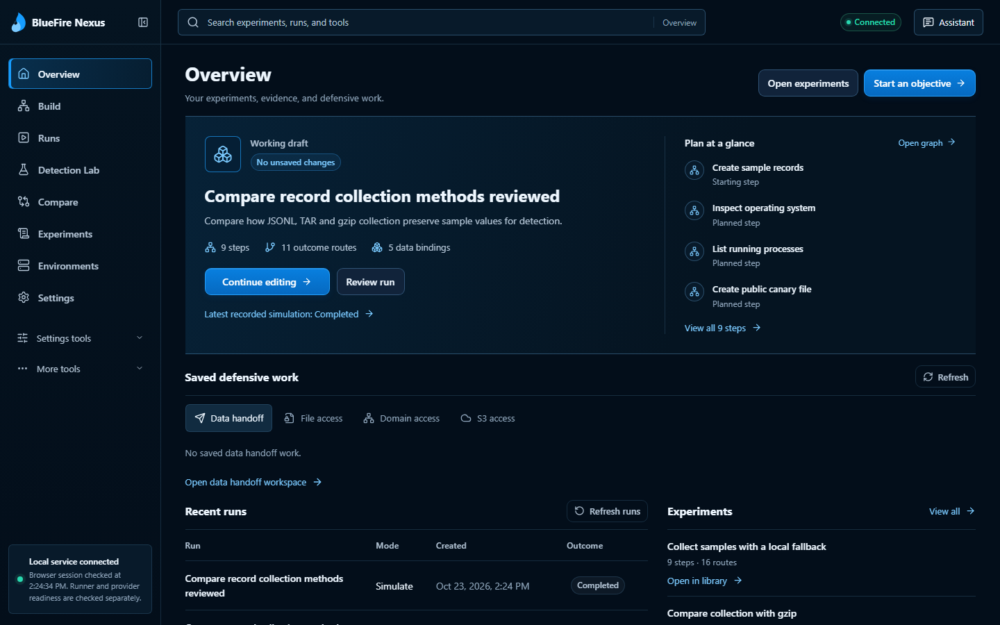
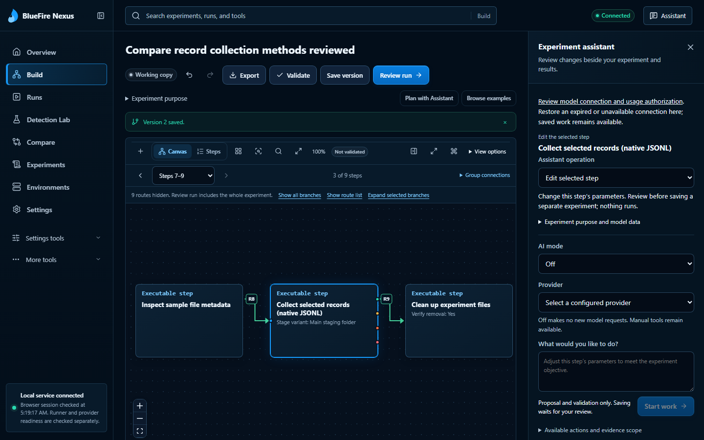
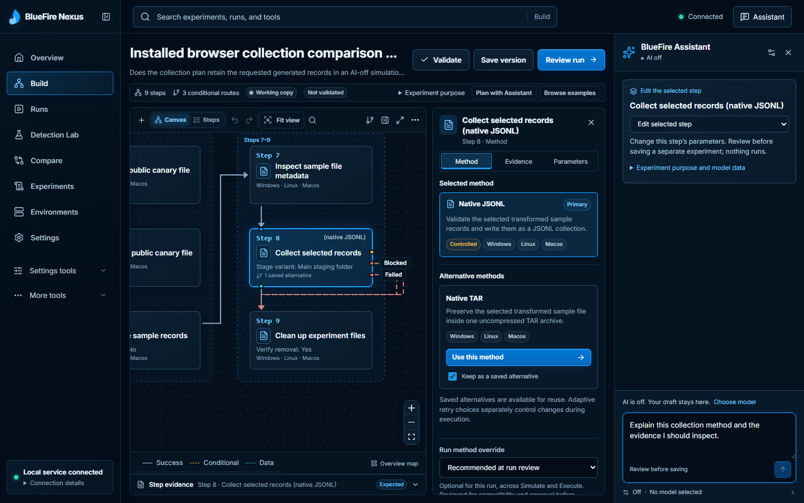
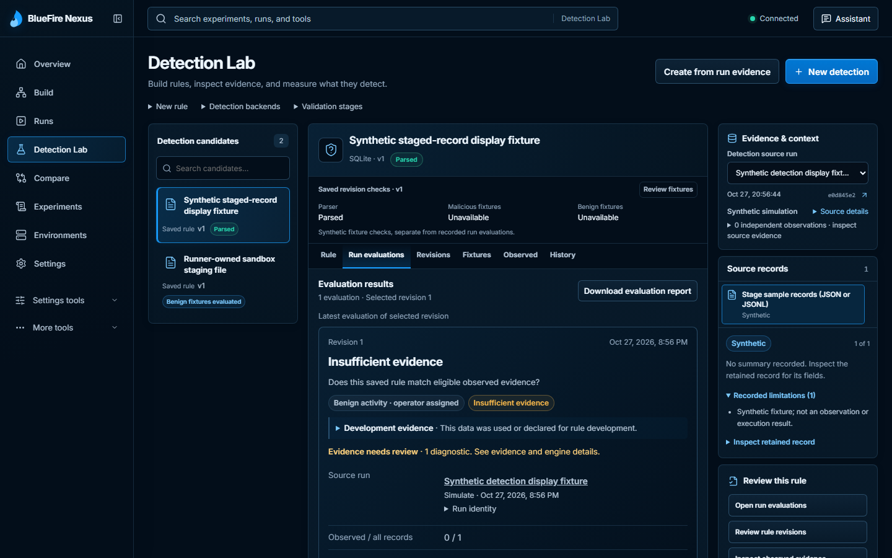
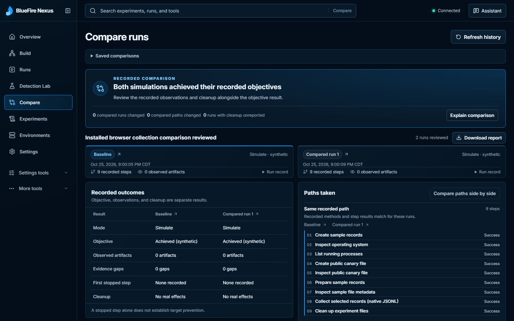

# The workspace

This is a tour of the BlueFire Nexus workspace: how you build an experiment, follow its run, test a defense, improve a detection and work with your model, and what is under the hood.

<strong>A visual workspace for purple teaming and detection engineering.</strong>

  
  
  

  <a href="INSTALLATION.md">Get started</a> ·
  <a href="#build-the-experiment">Workflow</a> ·
  <a href="OPERATOR_GUIDE.md">Documentation</a> ·
  <a href="https://github.com/Moneer-S/BlueFire-Nexus/issues/202">Roadmap</a>

BlueFire Nexus is an open-source, AI-first security experimentation and defense-validation workspace. Its desktop-oriented local interface connects objectives, composable attack-chain plans, reviewed execution, independent observations, defensive changes, and fresh retesting.

Connect behavior steps into an experiment, inspect the recorded outcome, then carry a run into detection work or compare it with another result. The optional AI Assistant works alongside the same workspace; manual editing and simulation remain available without an AI provider.

Watch the [development walkthrough](assets/screenshots/desktop-workflow.webm): explore a connected plan and its inspector, open a contextual Assistant draft, then revisit a saved comparison and detection evaluation. The installed build uses AI Off and clearly labeled synthetic records; both saved simulations took the same path. [Capture details](assets/screenshots/capture.json) identify the source revision and scope.

## Build the experiment

Choose the steps, how each step runs, and what happens next if it succeeds, fails, or is blocked. The topology-focused canvas groups connected steps for navigation and shows conditional routes and data dependencies; switch to the ordered step view when that is easier to review. Edit parameters, add compatible alternatives, and save immutable versions for another run.

Reopen an exact saved version without replacing it, or export the working experiment as JSON.

Work directly in the editor or use the Assistant to draft and revise the plan. From Build, the Assistant can use the current graph and selected-step context. Proposed graph changes remain reviewable before you apply them.

## Follow the run

Review the path taken, collected files and observations, errors, and cleanup status. Open a step to inspect its details rather than reconstructing the sequence from separate tool logs.

A step reporting success and a collector confirming its effects are shown separately. Saved results remain available for inspection, comparison, and export.

## Test the defense

Saved defensive workflows keep the original baseline, reviewed change, and follow-up tests connected. The generated-data receiver workflow distinguishes refusal of the original payload from acceptance of a redacted legitimate payload, retains the reviewed policy separately from temporary test cleanup, and offers a linked fresh retest.

Prevention, detection, execution success, and legitimate-use outcomes are separate results. A new rule evaluated against saved evidence is not a fresh execution against a changed environment.

## Improve the detection

Use **Detection Lab** to bring in a run as the evidence source, write a rule, and inspect matching records alongside examples that should not match. Save revised rules without losing earlier versions or evaluation results. **Compare** keeps run comparisons tied to selected runs, compares detector evaluations separately, and lets you revisit saved comparison snapshots. Download a report for a selected comparison.

Repeat the experiment or change a method, then open **Compare** to see the differences between runs. Compare rule evaluations separately to see which records each revision matched. Export the results when you need to share or investigate them further.

## Work with your model

The optional Assistant works beside the graph and results. It supports experiment planning, supported edits, and detection drafting and revision. Connect a compatible provider when you need it; manual operation remains available without one.

**Assist** asks you to review proposed changes. For supported operations, **Auto** can choose from alternatives included in the run you approved. It cannot add new targets or permissions. **Off** follows the saved plan without calling a model.

See [model setup and supported operations](AI_PLANNER.md). Live-provider validation is still in progress, and external providers may charge for usage.

## Under the hood

Python coordinates experiments and detection evaluation. The Rust runner performs supported actions. React provides the interface, and SQLite stores the workspace's saved records.

The framework includes native methods and reviewed external-tool adaptations, including a Linux gzip test adapted from Atomic Red Team. Detection backends include local SQLite, Sigma conversion to SQLite, and YARA for file content, subject to the installed backend requirements.

[`lab/`](../lab/README.md) is the engine for real runs: it runs published attack tests on a disposable host with real sensors and reports what the defenses saw. Its numbers, each with the CI run that shows it, are in [the lab's README](../lab/README.md).

[Architecture](ARCHITECTURE.md) · [Execution](EXECUTION_MODEL.md) · [Detection backends](DETECTION_LAB.md) · [Reviewed T1082 source intake](SOURCE_INTAKE.md) · [Development](DEVELOPMENT.md) · [Contributing](../CONTRIBUTING.md)
