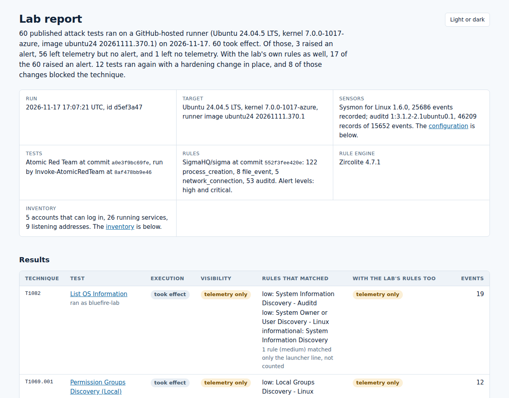

# BlueFire lab

A test bench for defenders. It runs published attack tests on a disposable lab
target, records what the sensors on that target saw, evaluates pinned detection
rules over those records, and reports two answers for every test: did the
technique take effect, and what did the defense see.

<picture>
  <source media="(prefers-color-scheme: dark)" srcset="../docs/report-dark.png">
  
</picture>

The top of the report of
[run 44133154347](https://github.com/Moneer-S/BlueFire-Nexus/actions/runs/44133154347),
as that run's job pictured it. The whole report is in the run's artifact.

## What it shows today

Everything in this section comes from one run of the `lab` workflow:
[run 44126989299](https://github.com/Moneer-S/BlueFire-Nexus/actions/runs/44126989299),
17 November 2026. Its run page shows the same answers in a longer table, and
its artifact `lab-run` holds the sensors' raw output (`sysmon.txt` and
`audit.txt`), the answers with what each rests on (`results.json`) and the full
report (`report.html`). GitHub keeps both for 90 days.

- **Target:** a GitHub-hosted `ubuntu-24.04` runner (Ubuntu 24.04.5, kernel
  7.0.0-1017-azure, runner image 20261111.370.1).
- **Tests:** 61 Linux tests from Atomic Red Team at commit `a0e3f9bc`, run
  unchanged by its executor, Invoke-AtomicRedTeam, at commit `8af478bb`. 60 of
  them ran: the runner has no `ccencrypt`, which the ccrypt test (T1486)
  needs, so the run left that test out and its report says so. Five run with
  one input argument changed; [`pinned-tests.yaml`](pinned-tests.yaml) says
  which and why.
- **Sensors:** Sysmon for Linux 1.6.0 with the configuration in
  [`sensors/sysmon.xml`](sensors/sysmon.xml), and auditd 3.1.2 with the rules
  in [`sensors/audit.rules`](sensors/audit.rules): watches on the shell start
  files, and the process starts of the lab's own steps and of what cron or a
  login starts.
- **Rules:** the 188 Linux rules of SigmaHQ release r2026-07-01 for the kinds
  of event these sensors record (122 for process creation, 8 for file events,
  5 for network connections, 53 for auditd), evaluated by Zircolite 4.7.1.
  Many of the 53 auditd rules look at records this auditd configuration does
  not produce: system calls it does not audit, files it does not watch, audit
  keys it does not set. In this run 18 of them matched anything.

All 60 tests took effect. Three of them raised an alert, meaning a match of a
rule of level high or critical on an event of the test. The last column counts
the lab's own rules too, those the run accepted: see
[Detection rules of the lab's own](#detection-rules-of-the-labs-own).

| Test | Visibility with the pinned rules (highest level that matched) | With the lab's rules too |
| --- | --- | --- |
| T1082 List OS Information | telemetry only (low) | telemetry only |
| T1069.001 Permission Groups Discovery (Local) | telemetry only (low) | telemetry only |
| T1518.001 Security Software Discovery - ps (Linux) | telemetry only (low) | telemetry only |
| T1057 Process Discovery - ps | telemetry only (none matched) | telemetry only |
| T1049 System Network Connections Discovery via ss or lsof (Linux/MacOS) | telemetry only (informational) | telemetry only |
| T1083 Nix File and Directory Discovery 2 | telemetry only (informational) | telemetry only |
| T1087.001 View accounts with UID 0 | telemetry only (none matched) | telemetry only |
| T1201 Examine password expiration policy - All Linux | telemetry only (none matched) | telemetry only |
| T1053.003 Cron - Replace crontab with referenced file | telemetry only (medium) | telemetry only |
| T1053.003 Cron - Add script to /etc/cron.d folder | telemetry only (low) | telemetry only |
| T1053.006 Create Systemd Service and Timer | telemetry only (low) | alert |
| T1543.002 Create Systemd Service | telemetry only (low) | alert |
| T1136.001 Create a user account on a Linux system | telemetry only (medium) | alert |
| T1098.004 Modify SSH Authorized Keys | telemetry only (none matched) | telemetry only |
| T1546.004 Add command to .bashrc | telemetry only (medium) | telemetry only |
| T1546.004 Add command to .bash_profile | telemetry only (medium) | telemetry only |
| T1546.004 Append commands user shell profile | telemetry only (medium) | telemetry only |
| T1037.004 rc.local | telemetry only (medium) | telemetry only |
| T1546.005 Trap EXIT | telemetry only (medium) | telemetry only |
| T1546.018 Python Startup Hook - usercustomize.py (Linux / MacOS) | telemetry only (medium) | alert |
| T1569.003 Enable systemd Service for Persistence with Auto-Restart | telemetry only (low) | alert |
| T1569.003 Create and Enable a Malicious systemd Service Unit | telemetry only (low) | alert |
| T1569.003 Masquerade Malicious Service as Legitimate System Service | telemetry only (low) | alert |
| T1569.003 Create systemd Service Unit from /tmp (Unusual Location) | telemetry only (low) | telemetry only |
| T1556.003 Malicious PAM rule | telemetry only (none matched) | telemetry only |
| T1078.003 Reactivate a locked/expired account (Linux) | telemetry only (medium) | telemetry only |
| T1552.003 Search Through Bash History | telemetry only (medium) | telemetry only |
| T1552.004 Discover Private SSH Keys | telemetry only (medium) | alert |
| T1552.004 Copy Private SSH Keys with CP | telemetry only (informational) | alert |
| T1552.004 Find TLS private key files | telemetry only (medium) | telemetry only |
| T1222.002 chmod - Change file or folder mode (numeric mode) | telemetry only (medium) | telemetry only |
| T1548.001 Set a SetUID flag on file | telemetry only (medium) | alert |
| T1548.001 Set a SetGID flag on file | telemetry only (medium) | alert |
| T1548.001 Make and modify capabilities of a binary | telemetry only (medium) | telemetry only |
| T1036.003 Masquerading as FreeBSD or Linux crond process | telemetry only (medium) | telemetry only |
| T1036.005 Execute a process from a directory masquerading as the current parent directory | telemetry only (low) | alert |
| T1564.001 Create a hidden file in a hidden directory | telemetry only (low) | telemetry only |
| T1070.006 Set a file's modification timestamp | telemetry only (medium) | telemetry only |
| T1070.003 Clear Bash history (truncate) | alert (high) | alert |
| T1070.003 Clear Bash history (echo) | no telemetry (none matched) | no telemetry |
| T1070.003 Clear Bash history (cat dev/null) | telemetry only (none matched) | telemetry only |
| T1070.003 Clear Bash history (ln dev/null) | telemetry only (medium) | alert |
| T1685.006 rm -rf | telemetry only (medium) | telemetry only |
| T1027 Decode base64 Data into Script | telemetry only (medium) | telemetry only |
| T1140 Linux Base64 Encoded Shebang in CLI | telemetry only (low) | telemetry only |
| T1059.004 Obfuscated command line scripts | telemetry only (low) | telemetry only |
| T1059.004 Shell Creation using awk command | alert (high) | alert |
| T1027.002 Binary simply packed by UPX (linux) | telemetry only (medium) | telemetry only |
| T1027.004 C compile | telemetry only (medium) | telemetry only |
| T1027.013 Password-Protected ZIP Payload Extraction and Execution | telemetry only (low) | alert |
| T1574.006 Shared Library Injection via LD_PRELOAD | telemetry only (none matched) | telemetry only |
| T1055.009 Inplace Instruction Overwrite | telemetry only (none matched) | telemetry only |
| T1560.001 Encrypts collected data with AES-256 and Base64 | telemetry only (low) | telemetry only |
| T1560.002 Compressing data using tarfile in Python (FreeBSD/Linux) | telemetry only (none matched) | telemetry only |
| T1030 Data Transfer Size Limits | telemetry only (low) | telemetry only |
| T1486 Encrypt files using openssl (FreeBSD/Linux) | telemetry only (none matched) | telemetry only |
| T1489 Linux - Stop service using systemctl | telemetry only (medium) | telemetry only |
| T1685 Disable ASLR Via sysctl parameters - Linux | alert (high) | alert |
| T1553.004 Install root CA on Debian/Ubuntu | telemetry only (medium) | telemetry only |
| T1548.003 Unlimited sudo cache timeout | telemetry only (medium) | telemetry only |

What that means for a defender, under these sensors and these rules:

- 56 tests took effect and left telemetry besides their launcher's start, but
  no pinned rule of an alert level fired. The lab's own rules close 14 of these
  gaps; 42 stay open. How much of a technique its telemetry shows differs: for
  the preloaded library (T1574.006) it is only the `ls` that ran, because
  neither sensor records the environment variable that carries the technique,
  except as part of the test's own command line, so no rule could close the
  gap without matching the test's text.
- Of the three pinned alerts, one would also fire on ordinary work. The alert
  on emptying the history with `truncate` (T1070.003) comes from "Binary
  Padding - Linux", a rule for another technique that matches any
  `truncate -s`: it matched the baseline's three ordinary uses of `truncate`
  in the same run. The other two, the awk shell escape and turning ASLR off
  with `sysctl` (T1685), matched nothing ordinary.
- One test left no telemetry: emptying the history with the shell's own
  `echo` (T1070.003 Clear Bash history (echo)) starts no program, auditd does
  not watch history files, and Sysmon reports a write to a file that exists
  already only when the file looks newly created afterwards, which this one,
  written by the test's preparation, did not. auditd's
  watch on the shell start files records the append to `~/.bashrc` that Sysmon
  cannot see, and recording process starts as well raised two of the alerts:
  see [A sensor change that makes a gap visible](#a-sensor-change-that-makes-a-gap-visible).
- On 31 of the tests, rules of level medium or lower matched only the one shell
  process whose command line holds the whole test. The report shows them, and
  does not count them as detections.

The canary, a test the pinned rules are known to catch (T1070.003, history
removal with `rm`), raised its alert at the start and at the end of the run. A
harmless command (T1082, `hostname`) ran through the same executor and raised
none. The first run of the first 49 of these tests,
[run 44033742721](https://github.com/Moneer-S/BlueFire-Nexus/actions/runs/44033742721),
before auditd recorded process starts, gave the same answers apart from the two
tests that change made alerts and one more: the in-place instruction overwrite
(T1055.009) had not taken effect, because the lab ended the process the test
writes into before that process ran what was written. The test now waits five
seconds before its check. The first run of the twelve others,
[run 44060562649](https://github.com/Moneer-S/BlueFire-Nexus/actions/runs/44060562649),
reported three systemd services (T1569.003) as attempted without effect: the
tests write their unit's command line inside quotes that its own quotes cut
short, so the unit runs without the redirect to its output file, and that file,
which each check read, stayed empty although each unit ran. The checks now read
systemd's own record that the unit ran and ended without error.

## Hardening that blocks a technique

In [run 44126989299](https://github.com/Moneer-S/BlueFire-Nexus/actions/runs/44126989299),
twelve tests ran once more after all the other tests, before the closing
canary, each with one of four hardening changes in place: `/tmp` mounted
`noexec` was tried on six tests, the account's `~/.bashrc` made immutable on
three, crontab limited by `/etc/cron.allow` on two. Eight of the twelve runs
were blocked: the test ran with its prerequisites met and did not take effect,
while it had taken effect without the change earlier in the same run. What
each test printed shows why:

| Test | Hardening change | What the test printed |
| --- | --- | --- |
| T1053.003 Cron - Replace crontab with referenced file | crontab limited to root with `/etc/cron.allow` | `You (bluefire-lab) are not allowed to use this program (crontab)` |
| T1098.004 Modify SSH Authorized Keys | the account's `~/.ssh` and `authorized_keys` owned by root | `cannot create /home/bluefire-lab/.ssh/authorized_keys: Permission denied` |
| T1546.004 Add command to .bashrc | the account's `~/.bashrc` made immutable | `cannot create /home/bluefire-lab/.bashrc: Operation not permitted` |
| T1036.003 Masquerading as FreeBSD or Linux crond process | `/tmp` mounted with `noexec`, `nosuid` and `nodev` | `/tmp/crond: Permission denied` |
| T1027.002 Binary simply packed by UPX (linux) | the same `/tmp` | `/tmp/packed_bin: Permission denied` |
| T1027.004 C compile | the same `/tmp`, where the test compiles | `./a.out: Permission denied` |
| T1574.006 Shared Library Injection via LD_PRELOAD | the same `/tmp` | `object '/tmp/T1574006.so' from LD_PRELOAD cannot be preloaded (failed to map segment from shared object): ignored.` |
| T1569.003 Enable systemd Service for Persistence with Auto-Restart | the same `/tmp`, where its service's program is | `ExecStart=/tmp/atomic_payload.sh (code=exited, status=203/EXEC)` |

Four runs were not blocked, and each shows what its change leaves open. With
`/tmp` mounted `noexec`, the password-protected ZIP payload (T1027.013) still
printed `T1027.013: Payload extracted from encrypted ZIP`: it runs its script
through `bash`, which the mount does not stop. With `/etc/cron.allow` in place,
root still wrote a job into `/etc/cron.d` (T1053.003 Cron - Add script to
/etc/cron.d folder): the file governs only the `crontab` command. With
`~/.bashrc` immutable, lines were still added to the account's other start
files (T1546.004), which the change does not cover: a command to
`~/.bash_profile`, and to `~/.profile` the comment that test appends. So `/tmp` mounted `noexec` blocked five of the six published procedures
it was tried on, `/etc/cron.allow` one of two, the immutable `~/.bashrc` one of
three and the root-owned `~/.ssh` one of one. The first four rows were first shown in
[run 44020766356](https://github.com/Moneer-S/BlueFire-Nexus/actions/runs/44020766356).

What the changes leave open beyond these was not tried: keys that root adds for
the account, moving the root-owned `~/.ssh` aside, which the account can do
because it owns its home folder, and programs run from `/dev/shm` or the
account's home folder. The changes are defined in
[`pinned-tests.yaml`](pinned-tests.yaml) under `defenses`.

## Detection rules of the lab's own

[`rules/linux`](rules/linux) holds Sigma rules this repository adds for tests
that took effect and left telemetry, but raised no alert from the pinned rules.
A rule describes what the technique does: for example any `chmod` mode that
sets the setuid or setgid bit, symbolic or numeric, and not only the mode a test
uses. It is accepted only when all three of these hold in the same run:

- it alerts on at least one published test;
- every published procedure it alerts on ran again with changed input arguments
  (the `variants` in [`pinned-tests.yaml`](pinned-tests.yaml)) and took effect,
  and it alerted on each of those runs;
- it matches nothing in the ordinary activity: a baseline of ordinary
  administration with the same tools and files, run as root and as the test
  account, and the runner's and the lab's own work outside the tests. The
  baseline adds and
  deletes accounts, among them a system account without a login shell; writes
  a systemd drop-in with a shell, copies a whole unit file into place with `cp`
  and masks a unit; changes file modes without the setuid or setgid bit;
  truncates and copies files that are not history files, and truncates one to
  a size other than zero; runs a program from `/tmp` and one from
  `~/.local/bin`; searches with `find` for files by other names; zips and
  unzips a file without a password; and writes an ordinary module into the
  account's own Python site folder.

This has a limit. Changed input arguments show that a rule does not depend on
the values they set, such as an account name or a file path. They cannot show
that a rule does not depend on what a test fixes in its command, such as the
options it passes to `useradd` or the mode it gives `chmod`: a rule written for
exactly those would be accepted as well. Where a test lets a run change what a
rule looks at, a variant does so for some rules and not yet for others: the
history tests run again on `~/.histfile` and `~/.history`, and the key search on
`id_ed25519`, but the systemd tests' variants change a unit's name and not the
folder it is written to, though two of those tests, T1053.006 and T1543.002,
allow that too. Beyond that, each
rule's description says which spellings it covers, and only the spellings the
tests use have been seen in a run.

The visibility answer stays the pinned rules' alone. A second column in the
report gives the answer with the accepted rules counted too, and a rule that is
not accepted changes no answer. In
[run 44126989299](https://github.com/Moneer-S/BlueFire-Nexus/actions/runs/44126989299),
three of the 60 tests raised an alert with the pinned rules, and 17 with the
accepted rules as well:

| Rule | Alerts on | Runs with changed input arguments | Verdict |
| --- | --- | --- | --- |
| [Systemd Unit File Written By A Shell](rules/linux/file_event/file_event_lnx_systemd_unit_written_by_shell.yml) | T1053.006 Create Systemd Service and Timer, T1543.002 Create Systemd Service, T1569.003 Enable systemd Service for Persistence with Auto-Restart, T1569.003 Create and Enable a Malicious systemd Service Unit, T1569.003 Masquerade Malicious Service as Legitimate System Service | alerted on 5 of 5 | accepted |
| [System Account Created With A Login Shell](rules/linux/process_creation/proc_creation_lnx_system_account_with_login_shell.yml) | T1136.001 Create a user account on a Linux system | alerted on 1 of 1 | accepted |
| [Setuid Or Setgid Bit Set With Chmod](rules/linux/process_creation/proc_creation_lnx_chmod_setuid_setgid.yml) | T1548.001 Set a SetUID flag on file, T1548.001 Set a SetGID flag on file | alerted on 2 of 2, one for each | accepted |
| [Shell History File Emptied](rules/linux/process_creation/proc_creation_lnx_history_file_emptied.yml) | T1070.003 Clear Bash history (truncate), T1070.003 Clear Bash history (ln dev/null) | alerted on 3 of 3, on `~/.zsh_history`, `~/.histfile` and `~/.history` | accepted |
| [Python Startup Hook File Written](rules/linux/file_event/file_event_lnx_python_startup_hook_written.yml) | T1546.018 Python Startup Hook - usercustomize.py (Linux / MacOS) | alerted on 1 of 1, with `python3.12` | accepted |
| [Private Key Files Searched With Find](rules/linux/process_creation/proc_creation_lnx_find_private_keys.yml) | T1552.004 Discover Private SSH Keys, T1552.004 Copy Private SSH Keys with CP | alerted on 2 of 2: for `id_ed25519`, and with another folder to copy to | accepted |
| [Program Run From A Folder Named Like Dots](rules/linux/process_creation/proc_creation_lnx_program_in_dots_folder.yml) | T1036.005 Execute a process from a directory masquerading as the current parent directory | alerted on 1 of 1 | accepted |
| [Archive Extracted With A Password On The Command Line](rules/linux/process_creation/proc_creation_lnx_archive_extracted_with_password.yml) | T1027.013 Password-Protected ZIP Payload Extraction and Execution | alerted on 1 of 1, with another password | accepted |
| [Program Named Like A System Daemon Run From A Temporary Folder](rules/linux/process_creation/proc_creation_lnx_daemon_name_from_temp_folder.yml) | T1036.003 Masquerading as FreeBSD or Linux crond process | none: the test has no input arguments to change | not accepted |

The rule for a unit file written by a shell was written for the first two of
its procedures. It also alerts on three more added to the list later, all
T1569.003, and on each one's run with changed input arguments. The rule for a
search for private key files, written for one procedure, also alerts on a
second, keys copied with `cp` after a `find`. Two other accepted rules alert on
two published procedures each, and four cover a single procedure each so far.

Other published procedures of the same techniques show where the rules stop.
The unit rule does not alert on a unit written in `/tmp` and linked into
systemd's folder (T1569.003 Create systemd Service Unit from /tmp): the shell
writes the unit outside systemd's folders, which the rule looks at, and
`systemctl` makes the link. The key rule does not alert on
a search for TLS key files (T1552.004 Find TLS private key files), which looks
for names such as `*.key` and `*.pem` that it does not describe. The setuid
rule does not alert on a file capability set with `setcap` (T1548.001 Make and
modify capabilities of a binary), a different way to the same privilege, for
which the pinned rule "Linux Setuid Capability Set on a Binary via Setcap
Utility" is of level low. And the history rule does not alert on
`cat /dev/null > ~/.bash_history` (T1070.003 Clear Bash history (cat dev/null)):
the redirection is the shell's, so no program start names the history file,
and Sysmon reported no write to it: it reports one to a file that exists
already only when the file looks newly created afterwards (see the Limits).

In the same run the baseline left 377 events and the runner's and the lab's own
work outside the tests 8,520, much of it the lab's own driver switching
accounts and sessions. None of the lab's rules matched any of them, while 20
pinned rules did. Two of those are of level high: the canary's own rule,
"History File Deletion", matched the baseline's removal of a copy of a history
file (`rm ~/.bash_history.bak`, record 1094), and "Binary Padding - Linux" its
three uses of `truncate`. The others are medium or lower, for example "User Has
Been Deleted Via Userdel" on the baseline's `userdel`.

The baseline is a short script, not days of real administration, so a rule that
stays quiet on it can still be noisy elsewhere. One such case is known: the
rule for a unit file written by a shell also alerts when an administrator
writes a new unit by hand. A draft that could not fire with this sensor is kept
in [`rules/rejected`](rules/rejected) with the reason.

## What the target has

Each run starts with an inventory of the target, and chooses the tests by it.
In [run 44028032549](https://github.com/Moneer-S/BlueFire-Nexus/actions/runs/44028032549)
(17 November 2026) the hosted runner had 5 accounts that can log in (`root`,
`runner`, the lab's own test account, and `packer` and `postgres`, which come
with the runner image), 26 running services before the lab started its sensors
(auditd among them, which the job installs), and 9 listening TCP and UDP addresses,
among them TCP port 22, the port SSH uses, on every address. Sysmon for Linux
and auditd were both active once started. Every program the tests then named
(`awk`, `crontab`, `systemctl`, `useradd`) was there, so no test was left out.
In [run 44126989299](https://github.com/Moneer-S/BlueFire-Nexus/actions/runs/44126989299)
the list names more programs, among them `ccencrypt` for the ccrypt test
(T1486), and the runner has no `ccencrypt`: the run left that test out, and its
report and run page list it with that reason.

## A sensor change that makes a gap visible

Sysmon for Linux reports a write to a file only when it leaves the file looking
newly created (see [Limits](#limits)), so with Sysmon alone appending a command
to `~/.bashrc` (T1546.004) left no telemetry, for example in
[run 44019934793](https://github.com/Moneer-S/BlueFire-Nexus/actions/runs/44019934793).
With auditd
recording beside Sysmon, watching the shell start files listed in
[`sensors/audit.rules`](sensors/audit.rules), it did in
[run 44029759448](https://github.com/Moneer-S/BlueFire-Nexus/actions/runs/44029759448)
(17 November 2026, kernel 7.0.0-1014-aws). auditd recorded the shell opening
`/home/bluefire-lab/.bashrc` for writing, in the audit session of the test's
attack step. Two pinned SigmaHQ auditd rules matched that record, "Unix Shell
Configuration Modification" (medium) and "Use Of Hidden Paths Or Files" (low),
so the test went from no telemetry to telemetry only. No test in the run is
left without telemetry.

The same test run with the account's `~/.bashrc` made immutable was still
blocked, and auditd recorded its write attempt too, refused by the kernel. Only
these two runs wrote to a watched file. The run's comparison with the latest
run on `main` finds them the only two of its 34 runs of a test whose answers
changed.

auditd also recorded what some of the tests' own programs report: `useradd`
adding the account of T1136.001, which the pinned auditd rule "Creation Of An
User Account" (medium) matched; `sudo` running each command of the setuid and
setgid tests; and cron starting the job the crontab test planted. None of these
changed an answer. All seven controls passed, with auditd's probe recorded
before the first test and its own count of lost records at 0 before and after.

### Process starts recorded by auditd too

With file watches alone, 3 of the 53 pinned auditd rules matched anything: many
of them look for a program's start and its arguments (EXECVE records). auditd
now records process starts as well: those of processes with a login uid. The
lab sets one at the start of every step, and cron and logins set one too, so
the machine's own cron jobs and what cron or a login starts for a test are
recorded as well, among them the user manager systemd starts for a login and
what that starts. The runner's agent and the system's services have none. In
[run 44055611236](https://github.com/Moneer-S/BlueFire-Nexus/actions/runs/44055611236)
18 auditd rules matched something, and two tests went from telemetry only to
an alert by a pinned rule:

| Test | Rule that alerts now |
| --- | --- |
| T1685 Disable ASLR Via sysctl parameters - Linux | ASLR Disabled Via Sysctl or Direct Syscall - Linux (high), on `sysctl -w kernel.randomize_va_space=0` |
| T1070.003 Clear Bash history (truncate) | Binary Padding - Linux (high), on `truncate -s0 ~/.bash_history` |

The second rule is for another technique and matches any `truncate -s`: it
matched the baseline's three ordinary uses of `truncate` in the same run, so a
defender would see it on ordinary work too. Compared with
[run 44055556881](https://github.com/Moneer-S/BlueFire-Nexus/actions/runs/44055556881),
the same tests without this change, only these two tests and the history
test's two runs with changed input arguments changed their answers, of 74.

Two things had to change with it. A shell given one command can become that
command in the same process (`bash -c "sysctl ..."`), so only the first program
start of the launcher's process is the launcher's, which, holding the whole
test, is never counted as a detection; the ASLR test's `sysctl` start, in the
same process, is the test's. And auditd rotates its log at 8 MB by default,
which it did during the first run with this change: the lab now sets it not to
rotate, and the loss control would fail a run in which it did; none has since.

## How a run works

1. The `lab` workflow ([`.github/workflows/lab.yml`](../.github/workflows/lab.yml))
   installs the two sensors, and fetches the tests, the executor, the rules and
   the rule engine at pinned versions. Nothing of theirs is copied into this
   repository: see [`THIRD_PARTY_NOTICES.md`](../THIRD_PARTY_NOTICES.md). The
   sensors are Sysmon for Linux, with [`sensors/sysmon.xml`](sensors/sysmon.xml),
   and auditd, with the file watches in [`sensors/audit.rules`](sensors/audit.rules).
2. `bluefire-lab run` stops at once, with the reason, if the target lacks
   `systemctl` or `ss`, which the lab itself needs. Before it starts the
   sensors, it takes an inventory of the target: the accounts that can log
   in, the running services, the listening addresses, and where each program
   the tests need is (`needs` in [`pinned-tests.yaml`](pinned-tests.yaml)).
   A test whose program is missing is left out, with its hardened runs and
   variants, and the report and the run page list it with the reason. After
   starting the sensors it records which of them are active, and waits until
   Sysmon reports a probe command and auditd a probe write to a file it
   watches. It then
   runs the tests on [`pinned-tests.yaml`](pinned-tests.yaml) one at a time,
   with the canary first and last, the harmless command second and the
   baseline of ordinary administration third. After the tests and before the
   closing canary, it runs once more each test that names a hardening change,
   with the change in place, and each test that names variants, with their
   input arguments. Root puts a change in place after the test's preparation
   and removes it after its cleanup. Each test runs
   as an unprivileged account whose outbound traffic is rejected, or as root
   when the test declares that it needs it. The account cannot change the
   lab's own files: the tests, the executor, the rules, the rule engine, the
   lab and the run's folder. The job checks that before the first test, and
   fails if it can, as it did in
   [run 44036033449](https://github.com/Moneer-S/BlueFire-Nexus/actions/runs/44036033449)
   before those files were made read-only for it; in the runs before that
   change, among them 44035796630, the account wrote the six files of the
   in-place instruction overwrite's prerequisite into the pinned tests'
   folder. Every step (preparation, a marker
   before and after the test, the test, an effect check, the cleanup) runs in a
   kernel audit session of its own.
3. `bluefire-lab evaluate` computes `results.json` from the files the run
   leaves. A Sysmon event belongs to a test when its process is in the audit
   session of the test's attack step. Two more rules apply inside the test's
   window, between its markers. What cron starts for the test account belongs
   to a test run as that account. What systemd starts belongs to a test run as
   root, unless the same command also ran outside every test's window. The
   executor's own commands and the test's preparation and cleanup are left out.
   So are the start and end of the shell process that carries the whole command
   line (`sh -c` or `bash -c`, as the test declares); files it writes count as
   the test's. An auditd record belongs to a test when its process is one that
   belongs to the test by those rules, or was forked by one and never started a
   program Sysmon saw (a subshell, or a start the kernel refused), which leaves
   out the driver's own records in the same session. It then judges each of
   the lab's own rules on
   the tests, their variants and the ordinary activity.
4. `bluefire-lab report` writes `report.html`, one file that loads nothing from
   elsewhere when it opens (it refuses to write one that would), and the same
   table for the run page.
5. `bluefire-lab recording` writes `recording.json`: the run as one file, made
   to be replayed step by step. It holds each step in order, the events tied to
   it and the rules that matched, taken only from `run.json` and
   `results.json`, with the digest of each rule folder of the run beside them.
   Its format is [`docs/RECORDING.md`](../docs/RECORDING.md).
   The job writes it whenever the evaluation wrote `results.json`, also when a
   control failed, and it is part of the run's artifact.
6. A separate job, which runs no test, compares the run's recording with that
   of the latest successful run on `main` (`bluefire-lab compare`, see
   [Comparing two recordings](#comparing-two-recordings)), writes `delta.md` to
   the run page, and keeps `delta.json` as the artifact `lab-delta`.

Seven controls must pass, or the run fails as a whole:

- **readiness:** both sensors recorded their probe before the first test began;
- **markers:** both markers and the launcher of every test are in the
  telemetry, and no answer is left inconclusive, for example because a
  hardening change could not be put in place or a test ran out of time with
  one;
- **changes:** every hardening change that was put in place was removed again
  after its test;
- **loss:** Sysmon reported its counts of lost and bad events once each, both
  zero, and none of its numbered records is missing from what was read or
  appears twice; and auditd's own count of lost records did not move during the
  run, nor did auditd rotate its log, which would leave records out of the
  export;
- **engine:** the rule engine loaded every rule and read every event it was
  given, and every category of rules had events to evaluate. That does not
  mean every rule could match: see the auditd limit below;
- **canary:** the known-detected test took effect and alerted, first and last;
- **control:** the harmless command took effect and raised no alert.

## Limits

- "No telemetry" means none under the pinned sensor configuration. Sysmon for
  Linux records process starts and ends, network connections, file deletions,
  and file creations. A file counts as created when it is opened for creation
  and its three timestamps are equal and less than 100 ms old. So a write to an
  existing file can show up as a creation when it leaves those timestamps
  fresh, as a read followed by an overwrite did for T1098.004 in run
  44035796630, though not in every run: whether it does depends on timing. An
  append that leaves the access time old, like the one to `~/.bashrc`, is not
  recorded by Sysmon, and neither are reads, permission changes and process
  environments. Sysmon can miss the creation of a new file too: in
  [run 44083991612](https://github.com/Moneer-S/BlueFire-Nexus/actions/runs/44083991612)
  it reported the deletion of the `usercustomize.py` that T1546.018 wrote and
  not its creation, while it reported both for that test's run with changed
  input arguments in the same job, so in that run the lab's rule for that file
  matched no published test and was not accepted. While `/tmp` is bind-mounted
  for the `noexec` change, Sysmon names files under it with the folder twice
  (`/tmp/tmp/crond`).
- auditd watches only the shell start files in
  [`sensors/audit.rules`](sensors/audit.rules), for writes and for changes of
  permissions, owner and extended attributes; `chattr`'s file flags, such as
  immutable, are not among them. It records the process starts of processes
  with a login uid, not those without one, such as the system services systemd
  starts for a test that runs as root. A start the kernel refused for a missing
  file is not counted when it was part of a search, the same process trying
  the same name in another folder, as a shell does along its search path. A
  single start of a missing file counts, such as the missing payload of the job
  T1053.003 plants, or `useradd` trying to start `nscd`, and so does a start
  refused for another reason, such as `noexec`; each is named by the file the
  kernel refused. Such a start is tied to a test only through its process: one
  of the test's, or a fork of one that left a record; a fork of a subshell that
  left none, or of a process that had already ended, is not. So many pinned
  auditd rules cannot match under it: those about other system calls, other
  files, or audit keys it does not set. Besides the watches it records what
  programs report about themselves, such as `useradd` adding an account or
  `sudo` running a command, and those records count for the test whose process
  wrote them. auditd's record of a process's command line (PROCTITLE) keeps
  the shell's, the start of the test's own text (the kernel keeps at most 128
  bytes), after the shell has become the one command it was given, and in a
  fork of the shell whose program the kernel refused; no pinned rule reads
  that record, and the report names a program start by its own arguments.
- A process that systemd starts for a test that runs as root is tied to the
  test by time, inside the test's window, and not by process ancestry. The
  runner's own timers are stopped before the tests, so that their units do not
  start inside such a window, and systemd's own steps are left out. A late
  step of systemd for an earlier test can still land in a later root test's
  window: in run 44040235251 logind's removal of the runtime folder of the
  account T1078.003 logs in as, 10 s after that test, was tied to T1548.001,
  which changed none of its answers. That removal is left out now; setting the
  folder up, when a test logs in, stays the test's. The user manager systemd
  starts for such a login gets a session of its own from it, so the time rule,
  which takes only what systemd started outside every session, ties it neither
  to that test nor to the ordinary activity.
- Outbound traffic, name lookups included, is rejected for the test account
  only, not for tests that run as root. The job checks a name lookup and a
  connection to an address it looked up itself before the tests.
- Two tests are checked more weakly than the rest. The awk shell escape
  (T1059.004) has no check of its own that could fail: awk exits with status 0
  whether or not the shell starts, so its "took effect" rests on the command
  having run. The security software discovery (T1518.001) is checked by a text
  that `ps` also prints for the test's own `grep`, so the check shows only that
  `ps` ran.
- One runner runs the whole list in sequence (the job took 13 to 16 minutes
  in the runs above), and GitHub hands out runners with different kernels
  under the same label: kernels 7.0.0-1017-azure (the run above) and
  7.0.0-1014-aws (run 44096893965, the same tests before the cron.d test's
  change) have both been seen.

## A range and its seal

A range is a small network of disposable containers, described by a spec file
under [`range/`](range). The lab brings it up with the plain Docker CLI, proves
that it is sealed, and takes it down again:

```bash
pip install ./lab
bluefire-lab range run lab/range/seal-check.yaml --out <new folder>
bluefire-lab range down lab/range/seal-check.yaml
```

It needs Docker Engine 28 or later on a local endpoint (`unix://` or
`npipe://`). Nothing in a range runs a published test yet: the containers of
[`seal-check.yaml`](range/seal-check.yaml) run nothing but the official nginx
image's web server, which gives the seal a real listener to connect to.

Every network is created `--internal` with the isolated gateway mode, so that
the Docker host has no address on it, and without IPv6. Every container is
created with the same few flags (a name and labels, its host name, its networks
with its host name as alias, `--dns-search .`, `net.ipv4.ip_forward=0`, a pids
and a memory limit, `--pull never`, and `--init` for a host built from the
spec) and nothing else. Every object is
addressed by the full ID Docker returned when it was created. The seal is
checked on the created containers
before any of them starts, then on the running ones, and once more where the
path of published tests will run:

- **Objects:** the run's label and the spec's prefix name exactly the
  containers and networks the run created, and no other container shares a
  range container's network, pid or ipc namespace (`--network container:<id>`
  leaves no trace on the network itself).
- **Networks:** internal, bridge, no IPv6, isolated gateway mode, and once the
  containers run, exactly the spec's members.
- **Containers:** the pinned image, or the image built from the spec under the
  tag of its build context, whose layers start with those of the image its
  Dockerfile pins by digest; not privileged; no added capability; no
  published port; no device, bind mount, volume or mount of any kind; no extra
  host, DNS server or DNS option; no host namespace; no unconfined security
  option; only the spec's networks, each with the host's alias. `--init` only
  where the engine sets it: Docker then mounts its own `docker-init` program
  read-only at `/sbin/docker-init`, a mount that `docker inspect` does not list
  under `Mounts`, so the check `container: init` names it.
- **Inside each container**, with a probe script that uses only bash,
  coreutils' `timeout` and `getent`: first a connection that must work (so that
  a broken tool cannot pass a probe that must fail), then every pair the spec
  derives (hosts that share a network must connect on each port the target
  listens on; hosts that share none must fail), four outside addresses (public
  resolvers and cloud metadata endpoints), and a canary: for the seal's
  duration the engine listens on a random TCP port on the Docker host, every
  container tries it at every gateway the daemon knows, and the canary must see
  no connection. A probe that must fail passes only when nothing answered
  (network unreachable, no route to host, or a timeout); a refused connection
  fails, since something routed the packet and answered it. Also: the TCP
  ports in LISTEN state on any address but loopback (read from
  `/proc/net/tcp` and `/proc/net/tcp6`) are exactly the ports the spec gives
  the host under `listens`, so that no port the matrix does not probe is open;
  routes only
  to the container's own subnets, forwarding off, no Docker socket, Docker's
  resolver only, range names resolving only to shared subnets and outside names
  not resolving.
- **Events:** a watch on Docker's events runs from before the first create to
  the end of the teardown, and any event on the range that the engine did not
  cause breaks the seal, as does the create or start of any other container
  that joins a range container's namespaces. The watch is checked once more
  after the teardown, as the seal's last phase: Docker must have reported the
  removal of every object, to a watch that was still running.

The run writes `seal.json` (every check, with the command it read, the value it
observed and whether it passed), `seal.md`, `manifest.json` and
`docker-events.ndjson` on every exit path, and takes the range down on every
exit path after the first create. Its exit code is 0 when the range was sealed
and still was at the end, 1 when it refused to start or Docker failed, 3 when
the seal failed and nothing ran in the range, and 4 when the run was made
invalid. `passed` at the top of `seal.json` is true only for a run that ended
sealed: a run that was stopped or made invalid after its checks had passed is
not recorded as passed. `range down` removes only containers and networks that
carry both the spec's prefix and its range label. One case leaves something for
it: Docker does not remove a network while a container from outside is still
connected to it. The run then records that its teardown was not complete, and
`range down` removes the network once that container is gone.

The job `seal` in `.github/workflows/range-one.yml` runs the passing case and
five planted breaks (`--plant` and a network connect from outside), each of
which must fail the seal for its own reason: a network that is not internal, a
network without the isolated
gateway mode (caught by the host canary as well), a published port, a bind
mount, and an extra container connected to a range network after the seal
(caught by the event watch).
[Run 45246204061](https://github.com/Moneer-S/BlueFire-Nexus/actions/runs/45246204061)
shows it on a GitHub-hosted runner with Docker Engine 28.0.4: the passing case
was sealed, each of the four `--plant` breaks was stopped by its own check, and
the connect was recorded by the event watch.

## The defense of a range

A range's defense is Wazuh: one manager and an agent inside each host it
watches. In [range one](#range-one-its-hosts) the agents are in `web`, `db`
and `build`, and the run shows that what happens on each of them reaches the
manager. No published test runs in it yet.

```bash
pip install ./lab
bluefire-lab range render lab/range/range-one.yaml --out <folder>   # optional: only writes the build files
bluefire-lab range run lab/range/range-one.yaml --out <new folder>
```

- **The pieces.** The manager is the official `wazuh/wazuh-manager` 4.14.10
  image, pinned by digest, alone: no indexer and no dashboard, and its Filebeat
  is kept from starting. Its rules are the stock ruleset. The lab adds one
  decoder, which reads the fields of snoopy's lines and raises no alert. The
  agent, package 4.14.10-1 checked against the SHA-512 in the spec, is baked
  into hosts built from Ubuntu noble, pinned by digest, with every package from
  the Ubuntu snapshot archive at the moment the spec names except the
  certificate store (ca-certificates and the openssl it needs), which comes
  from the live archive of the build day so that the snapshot can be reached
  over HTTPS; its version is not recorded. On those hosts
  snoopy 2.5.1 writes every program start to syslog, with the `BLUEFIRE_TAG` of
  the process that started it, and rsyslog writes the lines with timestamps to
  the microsecond. A host starts its services from a plain script, without
  systemd.
- **Images from the spec.** `range render` writes one multi-stage Dockerfile
  and a bake file. Every image is tagged with the spec's prefix and a hash of
  the build context, so `range run` builds with `docker buildx bake --load`
  only when a tag is missing or its image is not built on the pinned image
  (the pinned image's layers are read from its registry), and starts each
  container from the image ID it found. A local image under the right tag and
  on the right base is trusted to be what the context builds: nothing checks
  the rest of it. The containers have no mount of any kind: the manager image declares
  no volume, and its configuration is baked in under `/wazuh-config-mount/`,
  which the image's own start copies into place.
- **What the agent collects.** The lab never writes an ossec.conf of its own.
  The build takes the stock file that the agent package or the manager image
  installed and makes a short list of edits, each of which must find the exact
  text it expects in the stock file. `manifest.json` holds, for the manager and
  every agent, the diff against the stock file and each change with its label:
  - *lab addition*: the agent reads `/var/log/auth.log` and
    `/var/log/snoopy.log` (the stock file reads `/var/log/dpkg.log` already;
    the loader refuses a spec whose agent does not collect auth.log and
    snoopy.log, since the engine's nonces and marks are lines in them),
    and watches `/etc`, `/home`, `/root`, `/tmp` and `/var/tmp` in real time
    with inotify; the manager writes every event it receives to
    `archives.json`, whether or not a rule matched; the snoopy decoder.
  - *removed*: on the agent, the features the spec lists under `off`: command
    monitoring (the stock `df`, `netstat` and `last` on a timer), the security
    configuration assessment, rootcheck and the system inventory. They are
    periodic scans or inventories, not live telemetry of what happens on a
    host, and the commands would fill the archive. On the manager: the same
    features and its file monitoring, since the manager's own container is not
    a defended host; vulnerability detection and the indexer connection, which
    need an indexer and the internet; the check for a newer version; Filebeat.
    The manager's API listens on 127.0.0.1 only (`api.yaml`), since the range
    uses no API and the hosts on `mgmt` must not reach it.
  - *startup*: the agent reports to `manager` by its name in the range, enrolls
    itself on port 1515 with no password (only range hosts can reach the
    port), waits 1 s after enrolling instead of 20, and does not restart itself
    when the manager first sends it the shared configuration; the manager reads
    new agent keys every second.
- **Alert level.** `defense.wazuh.alert_level` (12 in range one) is the
  level from which a Wazuh alert will count as an alert when a step is scored,
  and `manifest.json` records it. It is not the manager's `log_alert_level`,
  which keeps its stock value 3, so that `alerts.json` also holds the matches
  below it for review. It changes no image. No step is scored yet.
- **Ready.** Before the dynamic seal, within 180 s of the start: the manager's
  ports 1514 and 1515 answer; each agent's state file says it is connected and
  its log says its real-time file monitoring started, with none of the errors
  after which a folder is not watched (inotify could not start, or its watch
  limit was reached); the manager's `agent_control` lists each agent active at
  the pinned version; and a nonce the engine sends to syslog on each agent host
  arrives in the manager's `archives.json`. The delay from the nonce to the
  archive is recorded. A range that is not ready stops with exit code 1 and a
  message that says which part failed and which copied file to read; a test
  shows this on stand-in files, and no run has shown it yet.
- **Versions.** In each phase of the seal, `agent_control` on the manager is
  run again, and the manager and every agent must report the pinned version.
- **Delivery.** Where the path of published tests will run, the engine makes a
  few harmless marks on each agent host: three lines sent to syslog, a file
  created and then changed in each folder watched in real time, and one
  program start, and records when each reached the archive. After the seal is
  checked again, the engine sends an end nonce and waits until the archive has
  caught up with each watched log. For each watched log, the lines written
  between the ready nonce and the end nonce are counted in the file copied out
  of the host, and each must be the full log of an event of that agent and
  location in the copied archive; an identical line outside the window does not
  count for one inside it. `delivery_gap` in `manifest.json` is true when a
  line is missing, a mark did not reach the archive, or one of Wazuh's own
  counters of lost events is above zero (analysisd, remoted, the agent's
  logcollector, and its log's lines about a full buffer or a full inotify
  queue); `delivery_findings` says which. It is null, and the summary says "not
  counted", when a log was not copied or is shorter than its window, or a mark
  was not made. A log with no line in the window is shown as not shown, not as
  delivered. logcollector writes its counters once a minute, so the manifest
  says whether they reach the end nonce; when they do not, its last minute is
  covered by the line count only. A lost event is a result about the defense,
  so it flags the run and does not fail it.
- **What the run keeps.** While the run lasts, two commands of the engine
  follow the manager's `archives.json` and `alerts.json` into `live/`, for a
  live view; no result is computed from them. After the run, `docker cp` by ID
  copies into `raw/hosts/<host>/` the manager's archives and alerts
  (compressed), its log, its state files and both ossec.conf files, and each
  agent host's watched logs, syslog, agent log, state files and ossec.conf
  files. Only folders and regular files are written: a link is left out and
  listed under `collected` in the manifest (Wazuh's own `archives.json` and
  `alerts.json` are links to the day's file, which is kept), so that nothing a
  container planted can make the lab read a file of the machine that runs it.
  `defense.md` sums it up for the job summary.

Some limits: snoopy does not see the first program of a `docker exec` (the
engine's `bash`), nor static programs; a process without `BLUEFIRE_TAG` has
the tag `(undefined)`. The agent package is for amd64 only.

The `range-one` job of the `range-one` workflow runs this on a GitHub-hosted
runner, fails unless there was no delivery gap, every agent host got its marks
and every mark arrived, snoopy's tag was decoded, every ossec.conf is the lab's
edits of the stock file and every plant check passed, and writes the build
time, the plant checks, the
ready delays, the marks, the delivery table and the seal to its summary. Each
image has a cache scope of its own in the GitHub Actions cache, and BuildKit
runs from its own image, pinned by digest.
[Run 45281159443](https://github.com/Moneer-S/BlueFire-Nexus/actions/runs/45281159443)
shows it for the seven hosts on a GitHub-hosted runner with Docker Engine
28.0.4 and AppArmor: the seal passed (201 checks before the start, 430 after
it and 430 again at the end), the range was ready 35 s after its containers
started, every plant check passed, and every line of the window was delivered
from `web`, `db` and `build` (for example `auth.log` 43 of 43 and `snoopy.log`
137 of 137 on `web`). The same
defense on a smaller range, one manager and one agent host, was shown by
[run 45262448946](https://github.com/Moneer-S/BlueFire-Nexus/actions/runs/45262448946)
on a GitHub-hosted runner with Docker Engine 28.0.4, from a build without a
cache: the range was sealed and ready 28 s after its containers started, the
ready nonce was in the manager's archive 0.2 s after it was logged, all 14
marks arrived, and every line of the window was delivered (`auth.log` 8 of 8,
`snoopy.log` 35 of 35), with every counter of lost events at zero.

## Range one: its hosts

[`range/range-one.yaml`](range/range-one.yaml) describes a small network: a
shop's web server, its database and its build server, watched by Wazuh, with
an attacker, the shop's customers and a stand-in internet outside. Each host
is built from the spec with what the path of published tests will need
planted in it. The network has no route out: everything outside is in the
range too.

| Host | Networks | Listens on | What is planted, and why |
| --- | --- | --- | --- |
| `attacker` | edge | nothing | The `src` folder of T1110.004 (its published password lists) under `/opt/atomics`, and `sshpass`, which that test's prerequisite would fetch: the first step guesses web's SSH password from there. |
| `inet` | edge | 80, 443 | The stand-in internet: a small server of the lab's own ([`inet_server.py`](bluefire_lab/range/inet_server.py)) that serves the published `atomic.sh` of T1105, which a step downloads, stores every `POST /upload` with its SHA-256, which the last step uses to send the stolen file out, and logs each request. Its certificate is made when the image is built. |
| `client` | edge | nothing | The shop's customers and its administrator's laptop: the account `ops`, whose SSH key `web` accepts. For the ordinary activity, which comes later. |
| `web` | edge, inside, mgmt | 22, 80 | The shop (nginx, PHP, one page that keeps a session and reads the database). The account `webadmin` with the password `webadmin`, which is on line 475 of the published list (the build checks that line). SSH with passwords, and `pam_unix` with `nodelay`, so that a failed password is answered without the usual pause of about 3 s, which over the 482 tries of the list would come to roughly 24 minutes (an estimate: not yet measured). In `webadmin`'s `~/.ssh`, a deploy key without a passphrase (`id_rsa`), which a step finds and the next uses, and a `known_hosts` entry for `build`, which a step reads and without which that `ssh` would stop. The database password in `/var/www/app/config.php`, which a step finds. `/tmp/stage`, owned by `webadmin`, where a step writes what it pulls from `build`. `ops` may run `nginx -t` with sudo. |
| `db` | inside, mgmt | 3306 | MariaDB with the shop's table, made when the image is built, and the user `shop`, allowed from any address with the password in `config.php`. |
| `build` | inside, mgmt | 22 | The account `deploy`, which accepts the deploy key, and `/etc/buildbot/signing.env`, readable by the group `deploy`: the path's goal is to get this file out to `inet`. A git repository of the shop, owned by `ci`, for the ordinary activity. |
| `manager` | mgmt | 1514, 1515 | The Wazuh manager. The agents on `web`, `db` and `build` also read nginx's logs on `web` and MariaDB's on `db`, and watch `/var/www`, PHP's sessions and `/srv/git` in real time. |

The files the spec plants from its folder are beside it: the shop's pages and
table in [`range/app`](range/app), the build server's repository in
[`range/repos/shop`](range/repos/shop). The SSH keys have no value outside
the range. They are made when the image stage that makes them is first built
and are then kept by the build cache, the GitHub Actions cache of CI
included, so ranges built from the same stage share them; `inet`'s
certificate is kept the same way.

```bash
pip install ./lab
bluefire-lab range run lab/range/range-one.yaml --out <new folder>
bluefire-lab range lock lab/range/range-one.yaml   # only when the spec's published files change
```

**Published files, pinned and locked.** The build fetches the technique YAML
of every step of the path, the `src` folders the hosts carry and the files
they serve, from Atomic Red Team at the spec's commit, and checks each against
its SHA-256 in [`range/range-one.lock`](range/range-one.lock). A file the lock
does not list, or lists with another hash, stops the build with its name.
`range lock` writes the lock. Atomic Red Team's licence (MIT), fetched and
locked the same way, goes with its files: to `build/atomics/LICENSE.txt` and
to `/opt/atomics/LICENSE.txt` on each host that carries or serves one. The
images carry the files as data, with the
commit in `/opt/atomics/COMMIT`, which the seal checks; no build step runs any
published text and no prerequisite is fetched: what one would install is a
package of the spec.

**What the run shows**, on top of the seal and the defense above: the seal's
matrix for seven hosts on three networks (every pair that shares a network
connects on each port the target listens on, every other pair fails); in the
ready gate, that each `known_hosts` entry is the host key of its host, and
that `web` and `client` fetch `inet`'s page over HTTP and HTTPS; and, after
the seal, a plant check for each thing the spec plants, each a single use of
it with the engine's own commands (tag `engine:plant`): each account's shell,
password (checked against its hash) and sudo rule, which the account then uses
once (`ops` runs `sudo -n nginx -t`); one SSH login with each planted password,
from `client` as `ops`, through PAM's auth stack as the first step will log
in; the SSH server's settings
and `nodelay`; the owner, group, mode and content of each planted folder and
file, and the files of the git repository; the database's user, grant and
settings, and a connection from `web` with the values in `config.php`; the
shop's page, fetched from `client`, with items from the database; one login
with each planted key, which also lists which planted files and secrets the
account may read (`deploy` may read the signing file, and not
`/etc/shadow`, `/etc/gshadow` or the host key); the served file, fetched
from `client`, with its locked SHA-256 and its line in `inet`'s log; one
upload of a few bytes, stored and indexed, and then removed so that the
path's upload is the first one; and every file of the `src` folder
`attacker` carries, with its locked SHA-256. The plant checks' pages,
uploads and password login are tried from `client`, never from a host where a
step runs, so that no check leaves a line that a step's own check looks for;
the ready gate's fetch of `inet`'s `/` from `web` is the one request from a
host of the path before the path, and no step looks for it. A plant check that
fails ends the run with exit code 1 after the seal, the marks and the
collection, unless the teardown or the event watch failed after it, which
then gives the run its result.

**Outputs**, in the run folder: `manifest.json` (with the lock, the planted
weaknesses in words, the ready gate and the plant checks with what each
command printed), `seal.json`, `seal.md`, `defense.md`, `plants.md`,
`docker-events.ndjson`, `build/` (the rendered Dockerfile, bake file and
build context) and `raw/hosts/<host>/`, which now also holds `inet`'s access
log and uploads.

The services (sshd, sudo, nginx, php-fpm, MariaDB) run under AppArmor's
`docker-default` profile on the hosted runner: run 45281159443's
`manifest.json` records the daemon's security options under `docker`, and
every plant check that uses them passed there.

Not yet shown: the path of published tests through the range; ordinary
activity; scoring.

## Range one: the path

`lab/range/range-one.yaml` holds the path of range one: eleven steps made of ten
published tests. `bluefire-lab atomic argv lab/range/range-one.yaml --atomics
<atomics folder> --out argv.json` writes, for each step, the argument vectors of
its attack, its prereq checks and its cleanup, read from the pinned YAML as
Invoke-AtomicRedTeam reads it. The job `atomic-parity` in
`.github/workflows/range-one.yml` runs Invoke-AtomicRedTeam for the same steps
with stand-ins for `sh` and `bash` that record how they were started and run
nothing, and fails on any byte that differs. In
[run 45246198695](https://github.com/Moneer-S/BlueFire-Nexus/actions/runs/45246198695)
every vector was identical: 11 steps, each with its attack, prereq check and
cleanup. A run of the path in range one's hosts: not yet shown.

## Not yet shown

- Tests on Windows, attack chains of several steps, and a lab on a local
  machine.

## How to run it

The workflow runs on pull requests that change `lab/`, on a weekly schedule,
and by hand from the Actions tab. Attack tests run on GitHub-hosted runners
only: `bluefire-lab run` refuses to start unless `RUNNER_ENVIRONMENT` is
`github-hosted`, which GitHub sets on its own runners. That guards against
starting it by mistake anywhere else; it cannot stop someone who sets the
variable on purpose.

The answers can be computed again from a run's artifact, on any machine:

```bash
pip install ./lab
bluefire-lab evaluate <folder of the unpacked artifact> --engine <path to Zircolite 4.7.1>
bluefire-lab report <folder of the unpacked artifact>
bluefire-lab recording <folder of the unpacked artifact> [--run-url <address of the CI run>] [--tests lab/pinned-tests.yaml]
```

`--tests` supplies the plain sentence of each test for a run made before
`run.json` recorded them; the recording's notes then say so.

Two runs' recordings can be compared the same way: see the next section.

## Comparing two recordings

"Before against after" is a claim about a cause: one thing changed, the same
tests ran again, and this is what changed. `bluefire-lab compare` is where that
claim is computed, and where it is refused:

```bash
bluefire-lab compare <before>/recording.json <after>/recording.json --out <folder> [--change detectors:lab]
```

It writes `delta.json`, whose format is the section "A delta" of
[`docs/RECORDING.md`](../docs/RECORDING.md), and `delta.md`, the same for a job
summary. `--change` declares the one thing that changed between the two runs:
`detectors:lab` for the rules in [`rules/linux`](rules/linux),
`detectors:pinned` for the published rules, or `sensors:sysmon` or
`sensors:auditd` for a sensor's settings. Left out, nothing was declared.

- **What was the same.** Each recording says how it was made: `source.setup`
  holds the tests' commit, the runner's image and kernel, and the SHA-256 of
  each sensor's settings as loaded, and each detector the `digest` of its rule
  files. The comparison lists every one of these, and each tool's version,
  that differs between the two. It gives no verdict, and still lists every
  step and what differed, when anything differs other than the declared
  change, when the declared change is the same in both, when the two are not
  of the same steps in the same order, or when a recording has no
  `source.setup`, as every recording made before this format had.
- **Pairing.** A step has the same id in every run of the same list (its role,
  its test, a hash of its input arguments, its hardening change, and a count
  for the canary, which runs twice), so steps pair by id. An older recording's
  steps pair by role, test and order, and each such pair says so. A step on one
  side only is listed as new or gone and never counted.
- **Like with like.** A change of the lab's rules is judged on the outcome with
  the lab's rules; the outcome by the published rules, whether a sensor
  recorded the step and whether the test took effect, which such a rule cannot
  change, are the control. A change of the published rules is judged on both
  outcomes, with whether a sensor recorded the step and whether the test took
  effect as the control. A change of a sensor's settings is judged also on
  whether a sensor recorded the step. A step whose control moved is run
  variation, not an effect, and is named as such. Each run decides anew which
  of the lab's rules it accepts, so the recording keeps, for each rule, whether
  the run accepted it and the digest of its file: a step that an unchanged rule
  matched in one run only is not credited to the change.
- **The control step.** The step of role `control` must raise no alert, so an
  alert on it is worse, and named as a false alert.
- **Its price, on the same line.** A step that got better carries what the
  gain cost, and a test step also how many of the list's published procedures
  of its technique got better. For the lab's rules the cost cannot be counted
  from the recording: a rule that matched ordinary activity is not accepted,
  and its matches are left out of the recording before it is written. The line
  says that, and quotes both recordings' notes on which rules were accepted,
  rather than a count that would read as zero.
- **The lab's code.** Two runs from different commits of this repository may
  differ because of the code, which the comparison does not check. It does not
  refuse for that, since a pull request always differs from `main`, but every
  verdict then says so, and `delta.md` names both commits.
- **No race.** The rules ran after each run, so there is no time to a first
  alert to compare, and the comparison makes none up.
- Every verdict rests on one pair of runs, and says so.

The job "compare with the latest run on main" of the `lab` workflow runs it
with nothing declared. Until a run on `main` has a recording with
`source.setup`, its comparison is refused for that reason, and lists the steps.

**The noise floor.** Runs
[45227119895](https://github.com/Moneer-S/BlueFire-Nexus/actions/runs/45227119895)
and [45288430599](https://github.com/Moneer-S/BlueFire-Nexus/actions/runs/45288430599),
the first of a pull request and the second on `main`, both on 23 November 2026, ran the same list with the same tests'
commit, runner image `ubuntu24 20261116.133.1` and kernel `7.0.0-1014-aws`, the
same sensor settings, rule sets and tool versions, from two commits of this
repository (`cb017990` and `2ca6c9e6`). Their recordings predate
`source.setup`, so they were written again from each run's artifact (`run.json`,
`results.json` and the two rule folders) with `bluefire-lab recording` of this
version and compared outside CI. That comparison found them comparable apart
from the lab's code, which it names, and all 91 steps the same in what
happened, in whether a sensor recorded them and in both outcomes. They do
differ below the outcomes: the recordings hold 1,931 and 1,923 events. No CI
run shows this comparison: it is not yet shown, and two runs are one sample of
the noise floor, not its measure.

## Before the loop: the sensor spike

Two runs on hosted runners tried sensors with harmless probe commands. Both are
from 16 November 2026, their logs are kept for 90 days and their artifacts
until 30 November 2026: [run A](https://github.com/Moneer-S/BlueFire-Nexus/actions/runs/43802339233)
and [run B](https://github.com/Moneer-S/BlueFire-Nexus/actions/runs/43803220104).
Run A ended as failed, in a step that only printed a summary of auditd's
records after auditd had loaded and recorded. Which kernel each sensor job had
is in the artifacts only.

- Sysmon for Linux 1.6.0, auditd 3.1.2 and Tetragon 1.8.0 all load on the
  runners' 7.0 kernels (runs A and B). Sysmon delivered a 6,051-character
  command line whole (run A).
- A child that detaches from its parent is reported with parent 1 by all three
  sensors, so process ancestry alone loses it (runs A and B). A kernel audit
  session, started by writing the login uid before a step, stays with every
  process of the step, detached ones included (run B). That is why the lab ties
  events to tests by session.
- Sysmon gives no parent identity to processes that PowerShell starts (run B),
  a known issue upstream (microsoft/Sysmon-Linux issue 253).
